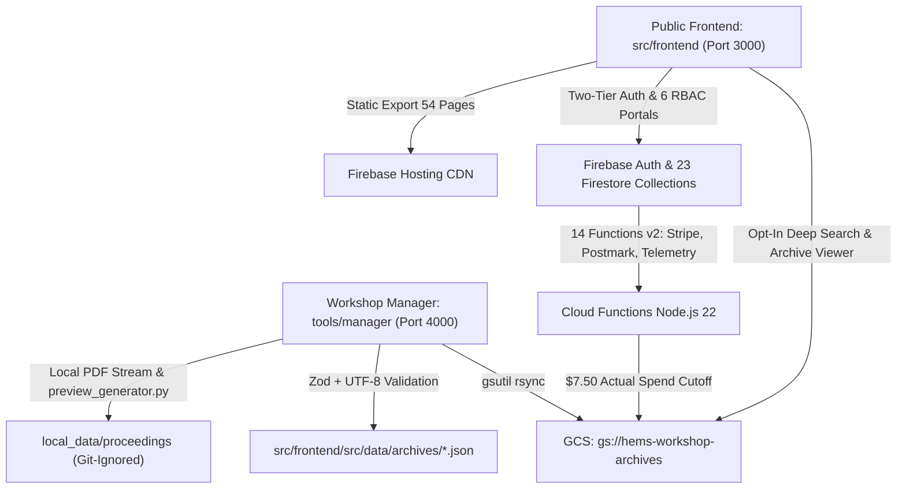

# HEMS Workshop Web Platform

Official web platform and historical research archive for the **Harsh-Environment Mass Spectrometry (HEMS) Society, Inc.** ([hems-workshop.org](https://www.hems-workshop.org)), an all-volunteer 501(c)(3) nonprofit scientific society (workshops since **February 1999**, Society incorporated **2008**).

> ### New Team & Officer Handover — Start Here
> Open **[`docs/system_design_architecture.html`](docs/system_design_architecture.html)** in any web browser for the complete **v5.3 Architecture, Design Rationale, Accounts/Credentials Map, 3-Layer Archive Setup, 53-Key Control Center, Reviewer Schedule Builder & Biennial Maintenance Manual**:
> ```powershell
> start docs\system_design_architecture.html   # Windows
> open docs/system_design_architecture.html    # macOS
> ```
> *(Tip: GitHub displays raw HTML source when clicking `.html` files — clone or download the file to view it formatted cleanly with interactive navigation and Print/Save-to-PDF support.)*

---

## Core Architecture Overview (`v5.3`)



- **Public Website (`src/frontend/`):** Next.js 16 (App Router, React 19, TypeScript 5, Tailwind CSS v4) compiled to a `$0/mo` static export (`output: "export"`, 54 routes), featuring Brand v3.2 (`Source Serif 4` + `Noto Sans`), **15 historical workshop proceedings (1999–2025; 436 works; 1,590 files)**, end-to-end UTF-8 Unicode/TeX equation rendering, Two-Tier Smart Sign-In (`DownloadGate` + `/auth`), and 6 isolated RBAC portals (`/abstract-submission`, `/reviewer/*` + **Conference Schedule Builder**, `/board`, `/operations/*`, `/treasurer`, and the **53-key** `/admin/workshop-settings`).
- **Offline Workshop Manager (`tools/manager/`):** Physically isolated local Next.js workbench on port `4000` for post-workshop PDF ingestion, Python thumbnail/text preview generation (`preview_generator.py`), Word-paste sanitization, sponsor management, and `gsutil rsync` syncing.
- **Serverless Backend (`functions/`):** 14 Firebase Cloud Functions v2 (Node 22) powering Stripe Card/`$5`-cap ACH checkout + webhooks, zero-tracking Postmark email blasts/receipts (`mail.hems-workshop.org`), cookie-free SHA-256 telemetry, verified-email whitelist role sync, and the `$5` Alert / `$7.50` GCS public-read billing circuit breaker.

---

## Key Documentation Index

| Document | Purpose |
| :--- | :--- |
| **[`docs/system_design_architecture.html`](docs/system_design_architecture.html)** | **Primary Team Handover Manual (v5.3):** ADRs, accounts/secrets ownership map, DNS/Postmark/Stripe setup, 3-layer archive onboarding, 53-key Control Center, Schedule Builder, Firestore matrix, & 24-month maintenance calendar |
| **[`docs/README.md`](docs/README.md)** | Quick index of all architecture blueprints, sprint plans, registries & design specs |
| **[`docs/project_charter.md`](docs/project_charter.md)** | Society domain scope & non-negotiable archive safety guardrails |
| **[`docs/design/brand-guidelines.md`](docs/design/brand-guidelines.md)** | Brand v3.2 typography, palette, photo curation & mobile layout rules |
| **[`docs/implementation_plan.md`](docs/implementation_plan.md)** | Complete Phase 1–29 implementation roadmap |
| **[`docs/session_history.md`](docs/session_history.md)** | Chronological engineering changelog (Addendums 1–52) |
| **[`infrastructure/postmark-dns-cutover.md`](infrastructure/postmark-dns-cutover.md)** | Google Workspace MX/SPF/DKIM, Postmark subdomain & DMARC DNS runbook |

---

## Repository Structure

```text
HEMS-website/
├── .github/workflows/       # GitHub Actions WIF deploy (--only hosting on main push)
├── docs/                    # Handover manual (system_design_architecture.html), plans, brand & history
├── firestore.rules          # 23-collection RBAC & verified-email Firestore security rules
├── functions/               # 14 Cloud Functions v2 (Node 22, TypeScript): Stripe, Postmark, Telemetry, Breaker
├── infrastructure/          # Staging (manage-board-preview.ps1), billing guardrails, DNS cutover & env templates
├── local_data/              # Git-ignored proceedings/ (1.68 GB) & cache/ + tracked sponsors/
├── tests/unit/              # 5 Node unit test suites (auth, mailing, 53-key schema, Unicode/TeX, Schedule Builder)
├── tools/manager/           # Local-only Archive & Proceedings Workbench (Port 4000 + Python previews)
└── src/frontend/            # Next.js 16 static web platform (Port 3000) & 54 exported routes
```

---

## Fresh Machine Onboarding (5 Steps)

**Prerequisites:** Node.js `20+` (dev uses `v24`, Cloud Functions target `22`), npm `10+`, Python 3 (`PyMuPDF` or `pypdf` for Manager previews), and Google Cloud / Firebase CLI (`webmaster@hems-workshop.org`).

1. **Install dependencies:**
   ```powershell
   npm --prefix src/frontend ci
   npm --prefix functions ci
   npm --prefix tools/manager ci
   ```
2. **Create untracked environment files (never commit):**
   - Copy `src/frontend/.env.example` to `src/frontend/.env.local` and populate public Firebase project keys (`hems-workshop`).
   - Copy `infrastructure/.env.postmark.example` + `infrastructure/.env.registration.example` to `functions/.env` (or Firebase Secret Manager) for Stripe & Postmark backend secrets.
3. **Authenticate GCP & Firebase:**
   ```powershell
   gcloud auth login webmaster@hems-workshop.org
   firebase login --reauth
   ```
4. **Pull git-ignored proceedings PDFs (`1.68 GB`) from Cloud Storage:**
   ```powershell
   gsutil -m rsync -r gs://hems-workshop-archives/proceedings local_data/proceedings
   ```
5. **Run local dev servers:**
   ```powershell
   npm run dev       # Public Website + All 6 Portals on http://localhost:3000
   npm run manager   # Local Archive Workbench on http://localhost:4000
   ```

---

## Verification, Staging & Deployment

```powershell
# Run all 5 unit test suites & TypeScript checks
node tests/unit/authWorkflow.test.mjs
node tests/unit/mailingAndWhitelistHygiene.test.mjs
node tests/unit/upcomingWorkshopCsv.test.mjs
node --test tests/unit/unicodeAndArchiveIntegrity.test.mjs
node --test tests/unit/conferenceScheduleBuilder.test.mjs
.\src\frontend\node_modules\.bin\tsc -p src\frontend\tsconfig.json --noEmit
.\functions\node_modules\.bin\tsc -p functions\tsconfig.json --noEmit

# Full Zod validation, search index build & static export (src/frontend/out)
npm run build

# Stage to unlisted Firebase Hosting preview channel (0 impact on live site)
npm --prefix src/frontend run preview:deploy

# Full cloud deploy when changing rules or functions (CI workflow deploys hosting only)
npm --prefix functions run build
firebase deploy --only firestore:rules,functions,hosting --project hems-workshop
```
