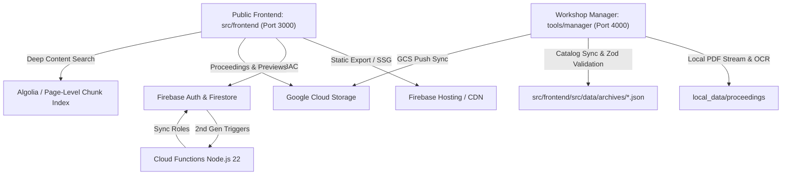

# HEMS Workshop Web Platform

Official web platform and historical research archive for the **Harsh-Environment Mass Spectrometry (HEMS) Society, Inc.** ([hems-workshop.org](https://www.hems-workshop.org)), a 501(c)(3) nonprofit public charity.

This platform serves as the central hub for society governance, biennial workshop announcements, registration, call for papers, accommodations, and an interactive digital archive spanning over two decades of mass spectrometry proceedings (1999–2025).

---

## 🏛️ System Architecture



* **Public Frontend (`src/frontend/`):** Next.js 16 (App Router) with React 19, TypeScript 5, and Tailwind CSS v4. Compiles cleanly to a lightweight static bundle (`output: "export"`).
* **Standalone Workshop Manager (`tools/manager/`):** Physically isolated local Next.js workbench running on port `4000` for inspecting proceedings, generating slide/abstract previews, managing corporate sponsor logos, and syncing to Google Cloud Storage.
* **Backend & Serverless (`functions/`):** Firebase Cloud Functions v2 (Node.js 22 runtime, 2nd Gen Firestore event triggers).
* **Database & Security:** Google Cloud Firestore with strict Role-Based Access Control (`admin`, `board`, `reviewer`, `submitter`, `attendee`, `general`), whitelist inheritance, and daily download quotas.
* **Deep Content Search & Biennial Workshop Config:** Pre-compiled page-level searchable PDF chunk index (`local_data/cache/` -> `public/mock-pdf-chunks.json`), Algolia search integration, and `$0` Google Workspace for Nonprofits Sheet + `upcoming_workshop.json` configuration (`docs/workshop-sheets/`).

---

## 📁 Repository Structure

```
HEMS-website/
├── .agents/                 # Antigravity Agile Release Train (ART) rules & personas
├── .github/workflows/       # GitHub Actions CI/CD (Firebase Hosting via WIF)
├── archive/                 # Git-ignored retired scrapers & legacy backup assets
├── docs/
│   ├── project_charter.md   # Canonical system charter & architectural guardrails
│   ├── source-documents/    # Canonical Mission Statement & Society History sources
│   ├── registries/          # Canonical SEO & 301 permalink registries
│   ├── plans/               # Permanent architectural sprint plans
│   └── logs/                # Silent Chain-of-Thought (SCoT) audit logs
├── local_data/              # Local proceedings, caches & canonical sponsor assets
│   ├── proceedings/         # Workshop 1–15 proceedings (1,590 files, 1.68 GB)
│   ├── sponsors/            # Master sponsor logo repository (91 assets)
│   └── cache/               # Extracted PDF page-text cache (615 JSON files)
├── scripts/                 # Workspace-level link & asset integrity auditors
├── firestore.rules          # Firestore security rules and RBAC policies
├── functions/               # Firebase Cloud Functions (Node.js 22, TypeScript)
├── tools/
│   └── manager/             # Standalone local Workshop Manager (Port 4000)
└── src/
    └── frontend/            # Public Next.js web application (Port 3000)
        ├── public/          # Lightweight static web assets & search indices
        ├── scripts/         # Pre-build Zod validation, indexing, Sheet sync & GCS push scripts
        └── src/
            ├── app/         # App Router pages & portals
            │   ├── (portal)/# Attendee & role-gated areas (Admin, Board, Reviewer)
            │   ├── about/   # Official Mission & Core Strategic Objectives
            │   ├── history/ # 1999–present Workshop & Society History
            │   ├── student-awards/        # Student Travel Awards guidelines & criteria
            │   ├── corporate-sponsorship/ # Evergreen Corporate Sponsorship & partner registry
            │   ├── archive/ # Dynamic 1999–2025 proceedings search & viewer (LOCKED)
            │   └── contact/ # Society & sponsorship inquiry hub
            ├── components/  # Modular UI & workshop-cycle components
            ├── hooks/       # Custom React hooks (live Google Sheet / JSON hydration)
            └── data/        # Master JSON datasets, upcoming_workshop.json & archives
```

---

## 🚀 Getting Started

### Prerequisites
* **Node.js:** v20+ or v22+
* **npm:** v10+

### Local Development

From the repository root:

1. **Start the Public Website (`http://localhost:3000`):**
   ```bash
   npm run dev
   ```

2. **Start the Standalone Workshop Manager (`http://localhost:4000`):**
   ```bash
   npm run manager
   ```

3. **Audit Proceedings & GCS Link Integrity:**
   ```bash
   npm run audit:assets
   ```

---

## 🛠️ Build & Deployment

### Production Build
To validate archive schemas with Zod, compile search indices, and generate the static export (`src/frontend/out/`):
```bash
npm run build
```

### Cloud Storage Asset Sync
To synchronize newly processed local proceedings and presentation PDFs with Google Cloud Storage:
```bash
npm run push-to-live
```

### Continuous Deployment
The repository is configured with GitHub Actions (`.github/workflows/firebase-hosting-merge.yml`). Merges or pushes to the `main` branch automatically execute static compilation and deploy to **Firebase Hosting** using Google Workload Identity Federation (WIF).
