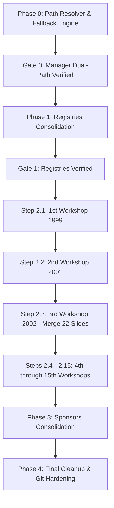

# Granular Implementation Plan: Workshop-by-Workshop Local Data Reorganization

This plan structures the local proceedings and registry reorganization into **discrete, verifiable checkpoints**—allowing **@bo** to inspect and verify progress **one workshop archive at a time**.

---

## User Review Required

> [!IMPORTANT]
> - **Zero-Downtime Dual-Path Engine (Phase 0):** Before moving files, we deploy [`assetPaths.ts`](file:///c:/AntigravityP1_2/HEMS-website/src/frontend/src/utils/assetPaths.ts). It resolves paths from `local_data/proceedings/[ws]` first, and automatically falls back to `docs/archives_translation/proceedings/[ws]`. The Workshop Manager continues working uninterrupted during partial migration.
> - **1 Workshop at a Time (Phase 2):** Each of the 15 workshop archives is processed, deduplicated under the **Manager Reference Authority Protocol**, and verified individually.
> - **Storage Reclaimed:** Each migrated workshop folder immediately deletes its redundant copy in `proceedings_backup/`, progressively freeing up **1.71 GB**.

---

## Phased Workflow & Checkpoint Architecture

---

## Detailed Step-by-Step Breakdown

### Phase 0: Centralized Path Architecture & Fallback Engine
Deploy the dual-path resolution module so both old and new locations function concurrently:

#### [NEW] [`src/frontend/src/utils/assetPaths.ts`](file:///c:/AntigravityP1_2/HEMS-website/src/frontend/src/utils/assetPaths.ts)
* `getProceedingsDir()`: Resolves to `local_data/proceedings` with fallback to `docs/archives_translation/proceedings`.
* `getWorkshopDir(wsOrdinal)`: Checks `local_data/proceedings/${wsOrdinal}` first; if missing, returns `docs/archives_translation/proceedings/${wsOrdinal}`.
* `getSponsorsDir()`: Resolves to `local_data/sponsors` with fallback.
* `getRegistriesDir()`: Resolves to `docs/registries`.

#### [MODIFY] Refactor Manager API routes to use `assetPaths.ts`:
* [`serve/route.ts`](file:///c:/AntigravityP1_2/HEMS-website/src/frontend/src/app/api/manager/serve/route.ts), [`upload/route.ts`](file:///c:/AntigravityP1_2/HEMS-website/src/frontend/src/app/api/manager/upload/route.ts), [`save/route.ts`](file:///c:/AntigravityP1_2/HEMS-website/src/frontend/src/app/api/manager/save/route.ts), [`push-to-live/route.ts`](file:///c:/AntigravityP1_2/HEMS-website/src/frontend/src/app/api/manager/push-to-live/route.ts), [`preview/route.ts`](file:///c:/AntigravityP1_2/HEMS-website/src/frontend/src/app/api/manager/preview/route.ts), [`download-legacy/route.ts`](file:///c:/AntigravityP1_2/HEMS-website/src/frontend/src/app/api/manager/download-legacy/route.ts), [`delete/route.ts`](file:///c:/AntigravityP1_2/HEMS-website/src/frontend/src/app/api/manager/delete/route.ts), [`check-file/route.ts`](file:///c:/AntigravityP1_2/HEMS-website/src/frontend/src/app/api/manager/check-file/route.ts).
* Scripts: [`push-to-live.js`](file:///c:/AntigravityP1_2/HEMS-website/src/frontend/scripts/push-to-live.js), [`index-pdf-contents.js`](file:///c:/AntigravityP1_2/HEMS-website/src/frontend/scripts/index-pdf-contents.js).

**Gate 0 Checkpoint:** Confirm Workshop Manager at `http://localhost:3000/manager` loads existing files without error.

---

### Phase 1: Registries Hub Consolidation
1. **[NEW] Directory:** `docs/registries/`
2. **[MOVE] Permalink Registry:** `docs/archives_translation/proceedings/redirect_map.json` -> [`docs/registries/permalink_registry.json`](file:///c:/AntigravityP1_2/HEMS-website/docs/registries/permalink_registry.json).
3. **[MOVE] SEO Metadata Registry:** `docs/design/pdf_seo_registry.md` -> [`docs/registries/pdf_seo_registry.md`](file:///c:/AntigravityP1_2/HEMS-website/docs/registries/pdf_seo_registry.md).
4. Update paths in `pdf_seo_registry.md` to reference `local_data\proceedings\...`.

**Gate 1 Checkpoint:** Inspect `docs/registries/` in IDE.

---

### Phase 2: Granular Workshop-by-Workshop Migration (15 Discrete Steps)

Each workshop follows a 4-point protocol:
1. **Audit:** Scan `master_workshops.json` & `archives/*.json` for all referenced files in this workshop.
2. **Deduplicate:** Reconcile `proceedings/[N]th` vs `proceedings_backup/[N]th` (Manager-referenced version is strictly retained).
3. **Move:** Relocate `proceedings/[N]th` -> `local_data/proceedings/[N]th`.
4. **Prune Backup:** Delete `proceedings_backup/[N]th`.

| Step | Workshop | Year | File Count | Size | Special Notes | Checkpoint |
| :--- | :--- | :--- | :--- | :--- | :--- | :--- |
| **2.1** | **1st Workshop** | 1999 | 2 files | 0.07 MB | Quick pilot test | [Gate 2.1: Verify 1999 in Manager](http://localhost:3000/manager) |
| **2.2** | **2nd Workshop** | 2001 | 52 files | 0.41 MB | First full oral/poster catalog | [Gate 2.2: Verify 2001 in Manager](http://localhost:3000/manager) |
| **2.3** | **3rd Workshop** | 2002 | 137 files | 20.1 MB | Merge 22 unique slides from backup | [Gate 2.3: Verify 2002 in Manager](http://localhost:3000/manager) |
| **2.4** | **4th Workshop** | 2003 | 44 files | 38.3 MB | Keynote & session papers | [Gate 2.4: Verify 2003 in Manager](http://localhost:3000/manager) |
| **2.5** | **5th Workshop** | 2005 | 130 files | 44.3 MB | Expanded technical sessions | [Gate 2.5: Verify 2005 in Manager](http://localhost:3000/manager) |
| **2.6** | **6th Workshop** | 2007 | 130 files | 71.9 MB | Full oral presentation set | [Gate 2.6: Verify 2007 in Manager](http://localhost:3000/manager) |
| **2.7** | **7th Workshop** | 2009 | 228 files | 153.9 MB | High volume session files | [Gate 2.7: Verify 2009 in Manager](http://localhost:3000/manager) |
| **2.8** | **8th Workshop** | 2011 | 166 files | 110.4 MB | Poster & oral proceedings | [Gate 2.8: Verify 2011 in Manager](http://localhost:3000/manager) |
| **2.9** | **9th Workshop** | 2013 | 132 files | 22.5 MB | Technical proceedings | [Gate 2.9: Verify 2013 in Manager](http://localhost:3000/manager) |
| **2.10**| **10th Workshop**| 2015 | 106 files | 142.7 MB | Heavy presentation slide sets | [Gate 2.10: Verify 2015 in Manager](http://localhost:3000/manager) |
| **2.11**| **11th Workshop**| 2017 | 104 files | 118.9 MB | Student award winning talks | [Gate 2.11: Verify 2017 in Manager](http://localhost:3000/manager) |
| **2.12**| **12th Workshop**| 2018 | 40 files | 94.2 MB | Streamlined sessions | [Gate 2.12: Verify 2018 in Manager](http://localhost:3000/manager) |
| **2.13**| **13th Workshop**| 2019 | 124 files | 721.4 MB | Largest media payload (721 MB) | [Gate 2.13: Verify 2019 in Manager](http://localhost:3000/manager) |
| **2.14**| **14th Workshop**| 2022 | 79 files | 74.9 MB | Modern session format | [Gate 2.14: Verify 2022 in Manager](http://localhost:3000/manager) |
| **2.15**| **15th Workshop**| 2025 | 94 files | 104.0 MB | Latest workshop archive | [Gate 2.15: Verify 2025 in Manager](http://localhost:3000/manager) |

---

### Phase 3: Sponsors Asset Consolidation & Manager Synchronization
*Detailed Architectural Plan:* [docs/plans/2026-09-02-sponsor-logos-reorganization.md](file:///c:/AntigravityP1_2/HEMS-website/docs/plans/2026-09-02-sponsor-logos-reorganization.md)

1. **Inventory & Harmonization:**
   - Migrate 67 historical raw assets from `docs/archives_translation/sponsors/` into `local_data/sponsors/`.
   - Harmonize with the 79 active web assets in `src/frontend/public/images/sponsors/` to form a unified 91-asset master archive in `local_data/sponsors/`.
2. **Manager API Sync:**
   - Verify `getSponsorsDir()` in [`assetPaths.ts`](file:///c:/AntigravityP1_2/HEMS-website/src/frontend/src/utils/assetPaths.ts) switches seamlessly to `local_data/sponsors/`.
   - Ensure manager routes (`check-file`, `upload`, `delete`, `save`, `registry`) maintain dual synchronization between `local_data/sponsors/` (master archive) and `public/images/sponsors/` (Firebase hosting static bundle).
3. **Registry Alignment:**
   - Cross-audit all entries in [`corporate_registry.json`](file:///c:/AntigravityP1_2/HEMS-website/src/frontend/src/data/corporate_registry.json) and workshop sponsor references to confirm 100% logo resolution.
4. **Pruning:**
   - Remove legacy `docs/archives_translation/sponsors/`.
5. **Gate 3 Checkpoint:** [PASSED] 91 unique sponsor assets unified into `local_data/sponsors/`. 0 missing logo files across 52 corporate registry entries and 131 workshop sponsor references. Manager health checks passing HTTP 200.

---

### Phase 4: Final Cleanup & Git Hardening [COMPLETED]
1. [x] Remove now-empty legacy directories: `docs/archives_translation/proceedings/`, `proceedings_backup/`, `raw_html/`, and parent `docs/archives_translation/`.
2. [x] Update [`.gitignore`](file:///c:/AntigravityP1_2/HEMS-website/.gitignore) to replace `docs/archives_translation/*/` with `local_data/`.
3. [x] Update [`README.md`](file:///c:/AntigravityP1_2/HEMS-website/README.md) with the finalized `local_data/` and `docs/registries/` architecture.
4. [x] Run full production build verification (`npm run build` in `src/frontend` and `functions`).
5. **Gate 4 Checkpoint:** [PASSED] `npm run build` passed with 0 errors across frontend and functions. Clean git hygiene with all local data and sponsor assets properly ignored or tracked.

---

### Phase 5: Frontend Webpages Modernization (Mission & History Integration) [COMPLETED]
*Detailed Architectural Plan:* [docs/plans/2026-10-27-frontend-webpages-revamp.md](file:///c:/AntigravityP1_2/HEMS-website/docs/plans/2026-10-27-frontend-webpages-revamp.md)

1. [x] **Source Ingestion:** Ingest and reformat canonical `mission-statementV1.md` and `historyV1.md` in `docs/source-documents/`.
2. [x] **About Page Overhaul:** Implement full mission statement, 5 core objectives grid, and interactive 1999–present chronological history in [`src/frontend/src/app/about/page.tsx`](file:///c:/AntigravityP1_2/HEMS-website/src/frontend/src/app/about/page.tsx).
3. [x] **Home Page Harmony:** Update hero and mission synopsis in [`src/frontend/src/app/page.tsx`](file:///c:/AntigravityP1_2/HEMS-website/src/frontend/src/app/page.tsx).
4. [x] **Archive Protection Gate:** Enforce zero modifications across proceeding datasets (`master_workshops.json`, `archives/*.json`, `local_data/proceedings/**`).

---

### Phase 6: Workspace Cleanup, CMS Content Sync & Public Society Pages [COMPLETED]
*Detailed Architectural Plans:* [docs/plans/2026-11-10-cleanup-and-archive-dev-fix.md](file:///c:/AntigravityP1_2/HEMS-website/docs/plans/2026-11-10-cleanup-and-archive-dev-fix.md), [docs/plans/2026-11-10-dedicated-history-page.md](file:///c:/AntigravityP1_2/HEMS-website/docs/plans/2026-11-10-dedicated-history-page.md), [docs/plans/2026-11-10-general-corporate-sponsorship-page.md](file:///c:/AntigravityP1_2/HEMS-website/docs/plans/2026-11-10-general-corporate-sponsorship-page.md) & [docs/plans/2026-11-10-student-travel-awards-page.md](file:///c:/AntigravityP1_2/HEMS-website/docs/plans/2026-11-10-student-travel-awards-page.md)

1. [x] **484 MB Static Bundle Reduction:** Relocated `public/assets/archives/cache` -> `local_data/cache/` and archived legacy `public/assets/archives/{2017,2018}` -> `archive/legacy_public_assets/` (shrinking `src/frontend/out/` from 508.2 MB to ~24.5 MB with zero data loss).
2. [x] **Strict Archive Page Lock & Local Proxy:** Preserved 100% zero diff on `src/frontend/src/app/archive/**` while proxying `/api/manager/*` to `localhost:4000` in `next.config.ts`.
3. [x] **Dedicated `/history` Page & `/about` Split:** Created [`src/frontend/src/app/history/page.tsx`](file:///c:/AntigravityP1_2/HEMS-website/src/frontend/src/app/history/page.tsx) holding the complete **Workshop & Society History** (`historyV1.md`) and focused [`src/frontend/src/app/about/page.tsx`](file:///c:/AntigravityP1_2/HEMS-website/src/frontend/src/app/about/page.tsx) on Official Mission & Core Strategic Objectives (`mission-statementV1.md`).
4. [x] **Evergreen Corporate Sponsorship Page (`/corporate-sponsorship`):** Promoted `/corporate-sponsorship` out of `(portal)/` to standalone [`src/frontend/src/app/corporate-sponsorship/page.tsx`](file:///c:/AntigravityP1_2/HEMS-website/src/frontend/src/app/corporate-sponsorship/page.tsx) with year-over-year copy modeled on `15thCorp_Sponsors.html`, dynamic 52-company showcase bound to [`corporate_registry.json`](file:///c:/AntigravityP1_2/HEMS-website/src/frontend/src/data/corporate_registry.json), and prominent entry via [`src/frontend/src/app/contact/page.tsx`](file:///c:/AntigravityP1_2/HEMS-website/src/frontend/src/app/contact/page.tsx) (excluded from `Navbar.tsx`).
5. [x] **Standalone Student Travel Awards Page (`/student-awards`):** Moved `/student-awards` out of `(portal)/` to standalone [`src/frontend/src/app/student-awards/page.tsx`](file:///c:/AntigravityP1_2/HEMS-website/src/frontend/src/app/student-awards/page.tsx) aligned 100% with `15thstudenttravel.html`, removed from `(portal)/layout.tsx` sidebar, and wired directly into [`Navbar.tsx`](file:///c:/AntigravityP1_2/HEMS-website/src/frontend/src/components/layout/Navbar.tsx), `Footer.tsx`, `sitemap.ts`, and Decap CMS.
6. [x] **Canonical CMS & UI Placeholder Polish:** Synced `src/frontend/content/pages/*.md` (including `history.md`, `corporate-sponsorship.md`, and `student-awards.md`), upgraded `/contact`, `/formatting-guidelines`, and `/layout-portal`, removed dead layout wrappers, and published [`docs/project_charter.md`](file:///c:/AntigravityP1_2/HEMS-website/docs/project_charter.md).

---

### Phase 7: Decap CMS Retirement & Google Sheets Upcoming Workshop Config (Sept 2027) [COMPLETED]
*Detailed Architectural Plan:* [docs/plans/2026-11-10-decap-retirement-and-google-sheets-workshop-config.md](file:///c:/AntigravityP1_2/HEMS-website/docs/plans/2026-11-10-decap-retirement-and-google-sheets-workshop-config.md)

1. [x] **Decap CMS Retirement:** Removed `src/frontend/public/admin/`, `src/frontend/content/`, and `docs/decap_cms_guide.html`, resolving the `/admin` static build collision while keeping `tools/manager/` (`localhost:4000`) dedicated exclusively to historical Proceedings Archives.
2. [x] **Canonical `upcoming_workshop.json` & Google Sheet Connector:** Created [`upcoming_workshop.json`](file:///c:/AntigravityP1_2/HEMS-website/src/frontend/src/data/upcoming_workshop.json) (seeded for the **16th HEMS Workshop • September 2027**), [`upcomingWorkshop.ts`](file:///c:/AntigravityP1_2/HEMS-website/src/frontend/src/utils/upcomingWorkshop.ts), [`useUpcomingWorkshop.ts`](file:///c:/AntigravityP1_2/HEMS-website/src/frontend/src/hooks/useUpcomingWorkshop.ts), and [`sync-workshop-sheet.js`](file:///c:/AntigravityP1_2/HEMS-website/src/frontend/scripts/sync-workshop-sheet.js).
3. [x] **8-Surface Website Ingestion Wiring:** Wired `/`, `/student-awards`, `/contact`, `/layout-portal`, `/call-for-papers`, `/registration`, `/accommodations`, and `/corporate-sponsorship` to `useUpcomingWorkshop()` with clean `TBA` / `"Opening Soon"` lifecycle states (`0` edits to `src/app/archive/**`).
4. [x] **Google Sheet Templates & Private Staging Guide:** Published ready-to-import [`1_Workshop_Config.csv`](file:///c:/AntigravityP1_2/HEMS-website/docs/workshop-sheets/1_Workshop_Config.csv), [`2_Website_Ingestion_Checklist.csv`](file:///c:/AntigravityP1_2/HEMS-website/docs/workshop-sheets/2_Website_Ingestion_Checklist.csv), and [`docs/workshop-sheets/README.md`](file:///c:/AntigravityP1_2/HEMS-website/docs/workshop-sheets/README.md).

---

### Phase 8: Brand Guidelines v3.0.0 & Editorial Academic Homepage [COMPLETED]
*Detailed Architectural Plan:* [docs/plans/2026-11-10-refined-academic-homepage-and-brand-v3.md](file:///c:/AntigravityP1_2/HEMS-website/docs/plans/2026-11-10-refined-academic-homepage-and-brand-v3.md)

1. [x] **Brand Archive & v3.0.0 Upgrade (`@brand`):** Archived `v2.0.0` to [`docs/design/archive/brand-guidelines-v2.0.0.md`](file:///c:/AntigravityP1_2/HEMS-website/docs/design/archive/brand-guidelines-v2.0.0.md) (and `.agents/config/design/archive/brand-guidelines-v2.0.0.md`) and authored **v3.0.0 — *"Scholarly Precision & Editorial Symposium"*** in [`docs/design/brand-guidelines.md`](file:///c:/AntigravityP1_2/HEMS-website/docs/design/brand-guidelines.md) and `.agents/config/design/brand-guidelines.md`.
2. [x] **Typography & Token Modernization (`@dev`):** Loaded `Source Serif 4`, `Noto Sans`, and `IBM Plex Mono` via `next/font/google` in [`layout.tsx`](file:///c:/AntigravityP1_2/HEMS-website/src/frontend/src/app/layout.tsx), eliminated render-blocking 6-font `@import` in [`globals.css`](file:///c:/AntigravityP1_2/HEMS-website/src/frontend/src/app/globals.css), and shifted global surfaces from muddy `#E2E8F0` to crisp Alabaster Paper `#FAFBFD` + Specimen White `#FFFFFF` with Oceanic Sapphire `#0369A1` and Instrumentation Teal `#0F766E`.
3. [x] **Refined Site Shell & Editorial Homepage (`@dev`):** Upgraded [`Navbar.tsx`](file:///c:/AntigravityP1_2/HEMS-website/src/frontend/src/components/layout/Navbar.tsx) (removed sine-wave background clutter, added emblem + serif wordmark lockup, active-route indicators, `"2027 Workshop"` label, and mobile drawer), [`Footer.tsx`](file:///c:/AntigravityP1_2/HEMS-website/src/frontend/src/components/layout/Footer.tsx), [`UpcomingHeroBadge.tsx`](file:///c:/AntigravityP1_2/HEMS-website/src/frontend/src/components/workshop/UpcomingHeroBadge.tsx), [`UpcomingWorkshopSpotlight.tsx`](file:///c:/AntigravityP1_2/HEMS-website/src/frontend/src/components/workshop/UpcomingWorkshopSpotlight.tsx), and [`page.tsx`](file:///c:/AntigravityP1_2/HEMS-website/src/frontend/src/app/page.tsx) (Editorial Split Hero with calibrated SVG EI 70 eV mass spectrum $m/z\ 1\text{–}100$, Institutional Impact Ledger, numbered Technical Charter pillars, 15th Workshop highlights, and Student Travel Awards / 501(c)(3) Sponsorship pathways).

---

### Phase 9: Website-Wide SEO, Scholarly Indexing & GEO Optimization [COMPLETED]
*Detailed Architectural Plan:* [docs/plans/2026-11-11-seo-optimization-architecture.md](file:///c:/AntigravityP1_2/HEMS-website/docs/plans/2026-11-11-seo-optimization-architecture.md)

1. [x] **Centralized SEO & Knowledge Graph Engine (`@dev`):** Implement [`src/frontend/src/utils/seo.ts`](file:///c:/AntigravityP1_2/HEMS-website/src/frontend/src/utils/seo.ts) providing trailing-slash canonical metadata builders, OpenGraph/Twitter card defaults, `Organization`/`NGO` + `WebSite` Knowledge Graph JSON-LD, upcoming `Event` JSON-LD, and `BreadcrumbList` generators; wire into [`layout.tsx`](file:///c:/AntigravityP1_2/HEMS-website/src/frontend/src/app/layout.tsx) and [`manifest.ts`](file:///c:/AntigravityP1_2/HEMS-website/src/frontend/src/app/manifest.ts).
2. [x] **Brand v3.0.0 Social Share Assets (`@dev`):** Generate deterministic `1200×630` `opengraph-image.png` and `twitter-image.png` (plus `.alt.txt`) in `src/frontend/src/app/` so all routes—including locked `/archive/**` pages—emit `summary_large_image` social previews.
3. [x] **Archive Event & ScholarlyArticle JSON-LD Repair (`@dev`):** Upgrade [`generateArchiveJsonLd.ts`](file:///c:/AntigravityP1_2/HEMS-website/src/frontend/src/utils/generateArchiveJsonLd.ts) to parse en-dash (`–`) and yearless workshop dates (`15/15` valid ISO `startDate`/`endDate`), fix `"False"` string -> boolean `false`, and enrich `Event` + `ScholarlyArticle` properties (`0` edits to `src/frontend/src/app/archive/**`).
4. [x] **Sitemap, Robots, `llms.txt` & Private Route `noindex` (`@dev`):** Normalize all `27` public URLs to trailing slashes with `<lastmod>` in [`sitemap.ts`](file:///c:/AntigravityP1_2/HEMS-website/src/frontend/src/app/sitemap.ts), harden [`robots.ts`](file:///c:/AntigravityP1_2/HEMS-website/src/frontend/src/app/robots.ts), add `noindex, nofollow` layouts for `/auth`, `/admin`, `/board`, `/reviewer`, and overhaul [`public/llms.txt`](file:///c:/AntigravityP1_2/HEMS-website/src/frontend/public/llms.txt).
5. [x] **Page-Level Metadata, `ContactClient` Split & Intrinsic Image Dimensions (`@dev`):** Extract [`ContactClient.tsx`](file:///c:/AntigravityP1_2/HEMS-website/src/frontend/src/components/workshop/ContactClient.tsx), apply unique canonical metadata + JSON-LD across all 11 non-archive public pages, fix `h2` -> `h3` hierarchy in [`formatting-guidelines/page.tsx`](file:///c:/AntigravityP1_2/HEMS-website/src/frontend/src/app/formatting-guidelines/page.tsx), and add explicit `width`/`height` image attributes.
6. [x] **Archive–Manager Architectural Review & Authorized Archive SEO Completion (`@arch`, `@dev`):** Reviewed the one-way `tools/manager` -> `master_workshops.json` -> `archives/[year].json` -> `build-prod.js` pipeline ([`2026-11-11-archive-manager-review-and-seo-updates.md`](file:///c:/AntigravityP1_2/HEMS-website/docs/plans/2026-11-11-archive-manager-review-and-seo-updates.md)); extracted [`ArchiveHubClient.tsx`](file:///c:/AntigravityP1_2/HEMS-website/src/frontend/src/components/archive/ArchiveHubClient.tsx) (fixing the missing `2025` browse card via dynamic `master_workshops.json` derivation), converted [`archive/page.tsx`](file:///c:/AntigravityP1_2/HEMS-website/src/frontend/src/app/archive/page.tsx) to a Server Component with `CollectionPage` + `ItemList` + `BreadcrumbList` JSON-LD, and upgraded [`archive/[year]/page.tsx`](file:///c:/AntigravityP1_2/HEMS-website/src/frontend/src/app/archive/%5Byear%5D/page.tsx) with trailing-slash canonicals, `1200×630` `og:image`/`twitter:image`, `BreadcrumbList` JSON-LD, and intrinsic `width`/`height` attributes (`0` mutations to archive JSON datasets or Manager routes).

---

### Phase 10: Website-Wide Cell Phone & Tablet Compatibility [COMPLETED]
*Detailed Architectural Plan:* [docs/plans/2026-11-11-mobile-and-tablet-compatibility.md](file:///c:/AntigravityP1_2/HEMS-website/docs/plans/2026-11-11-mobile-and-tablet-compatibility.md)

1. [x] **Viewport Metadata & Global Overflow Guards (`@dev`):** Export explicit Next.js `Viewport` (`device-width`, `initialScale: 1`, `viewportFit: "cover"`, `themeColor: "#FAFBFD"`) in [`layout.tsx`](file:///c:/AntigravityP1_2/HEMS-website/src/frontend/src/app/layout.tsx) and add `overflow-x: clip` + `.no-scrollbar` touch rail helpers in [`globals.css`](file:///c:/AntigravityP1_2/HEMS-website/src/frontend/src/app/globals.css).
2. [x] **Tablet-Safe & Touch-First Site Shell (`@dev`):** Promote desktop horizontal nav in [`Navbar.tsx`](file:///c:/AntigravityP1_2/HEMS-website/src/frontend/src/components/layout/Navbar.tsx) from `md:flex` to `lg:flex` (`1024px+`) to eliminate portrait-tablet (`768px–1023px`) horizontal overflow; add tap/click toggles with outside-click & `Escape` dismissal for `Archives` and signed-in `User` popovers on landscape touch tablets; upgrade the `< 1024px` drawer with `44px` tap targets, collapsible `2027 Workshop` & `Proceedings Archives` sub-menus, and authenticated `Admin` / `Sign Out` controls; expand tap spacing in [`Footer.tsx`](file:///c:/AntigravityP1_2/HEMS-website/src/frontend/src/components/layout/Footer.tsx).
3. [x] **Mobile & Portrait-Tablet Workshop Portal Sub-Navigation (`@dev`):** Promote the fixed left sidebar in [`(portal)/layout.tsx`](file:///c:/AntigravityP1_2/HEMS-website/src/frontend/src/app/%28portal%29/layout.tsx) to `lg:flex lg:w-64`, inject a sticky touch-scrollable horizontal pill sub-navigation bar (`lg:hidden`) across all authorized portal and officer routes, normalize trailing slashes for active states, and add `min-w-0` + responsive padding to prevent flex/table blowouts.
4. [x] **Homepage, Subpage, Modal & iOS Safari `16px` Form Ergonomics (`@dev`):** Fix 2×2 / 4-col Impact Ledger border/padding alignment and narrow-phone CTAs in [`page.tsx`](file:///c:/AntigravityP1_2/HEMS-website/src/frontend/src/app/page.tsx), [`UpcomingHeroBadge.tsx`](file:///c:/AntigravityP1_2/HEMS-website/src/frontend/src/components/workshop/UpcomingHeroBadge.tsx), and [`UpcomingWorkshopSpotlight.tsx`](file:///c:/AntigravityP1_2/HEMS-website/src/frontend/src/components/workshop/UpcomingWorkshopSpotlight.tsx); gate [`FrontendPreviewHover.tsx`](file:///c:/AntigravityP1_2/HEMS-website/src/frontend/src/components/FrontendPreviewHover.tsx) (`hidden md:block`, `w-[min(400px,calc(100vw-2rem))]`); add `max-h-[90dvh] overflow-y-auto` to [`DownloadGate.tsx`](file:///c:/AntigravityP1_2/HEMS-website/src/frontend/src/components/DownloadGate.tsx) & [`CitationModal.tsx`](file:///c:/AntigravityP1_2/HEMS-website/src/frontend/src/components/CitationModal.tsx); upgrade form controls to `text-base sm:text-sm` (`16px` mobile) to prevent iOS Safari focus zoom; and apply responsive card padding, unbroken string wrapping (`break-all`), and wrapping action rows across all subpages and officer panels (`0` edits to `src/frontend/src/app/archive/**`).

### Phase 11: History Milestone Trim & Provenance-Driven Photo Captions [COMPLETED]
*Detailed Architectural Plan:* [docs/plans/2026-11-11-editorial-trim-and-provenance-captions.md](file:///c:/AntigravityP1_2/HEMS-website/docs/plans/2026-11-11-editorial-trim-and-provenance-captions.md)

1. [x] **Remove Redundant `'Key Historical Milestones'` Section (`@dev`):** Delete `TIMELINE_EVENTS` and Chapter 03 from [`src/frontend/src/app/history/page.tsx`](file:///c:/AntigravityP1_2/HEMS-website/src/frontend/src/app/history/page.tsx), renumbering Chapter 04 to `03 — Summary & The HEMS Philosophy` with balanced section contrast.
2. [x] **Provenance-First Photo Captions Across All 8 Public Routes (`@prod`, `@dev`):** Replace visual-description captions across [`page.tsx`](file:///c:/AntigravityP1_2/HEMS-website/src/frontend/src/app/page.tsx), [`about/page.tsx`](file:///c:/AntigravityP1_2/HEMS-website/src/frontend/src/app/about/page.tsx), [`history/page.tsx`](file:///c:/AntigravityP1_2/HEMS-website/src/frontend/src/app/history/page.tsx), [`PortalOverviewClient.tsx`](file:///c:/AntigravityP1_2/HEMS-website/src/frontend/src/components/workshop/PortalOverviewClient.tsx), [`AccommodationsClient.tsx`](file:///c:/AntigravityP1_2/HEMS-website/src/frontend/src/components/workshop/AccommodationsClient.tsx), [`CallForPapersClient.tsx`](file:///c:/AntigravityP1_2/HEMS-website/src/frontend/src/components/workshop/CallForPapersClient.tsx), [`CorporateSponsorshipClient.tsx`](file:///c:/AntigravityP1_2/HEMS-website/src/frontend/src/components/workshop/CorporateSponsorshipClient.tsx), and [`StudentAwardsClient.tsx`](file:///c:/AntigravityP1_2/HEMS-website/src/frontend/src/components/workshop/StudentAwardsClient.tsx) with EXIF- and Program-verified unseen context (dates, hotels/venues, cities, sessions, and authors/affiliations) while preserving screen-reader `alt` attributes (`0` edits to `src/frontend/src/app/archive/**`).

### Phase 12: Brand Guidelines v3.1.0 Sitewide Rollout & Web Image Optimization [COMPLETED]
*Detailed Architectural Plan:* [docs/plans/2026-11-11-brand-v3-1-typography-and-image-optimization.md](file:///c:/AntigravityP1_2/HEMS-website/docs/plans/2026-11-11-brand-v3-1-typography-and-image-optimization.md)

1. [x] **Retire `IBM_Plex_Mono` & Roll Out Dual-Font `v3.1.0` (`@dev`):** Removed `IBM_Plex_Mono` from [`layout.tsx`](file:///c:/AntigravityP1_2/HEMS-website/src/frontend/src/app/layout.tsx), aliased `--font-mono` to `var(--font-noto-sans)` in [`globals.css`](file:///c:/AntigravityP1_2/HEMS-website/src/frontend/src/app/globals.css), replaced `font-mono` / `var(--font-ibm-mono)` across all 24 unlocked frontend files with `Noto Sans` (`tabular-nums` on dates/fees/metrics), and regenerated `2x` supersampled `opengraph-image.png` & `twitter-image.png` (`0` edits to `src/frontend/src/app/archive/**`).
2. [x] **Web-Sized Photography, Non-Generative Quality Polish & Before/After Archive (`@dev`, `@ops`):** Optimized all 21 images in `src/frontend/public/images/{history,gallery}/` (`73.59 MB` -> `4.95 MB`, `-93.3%`, with the 11 camera JPEGs dropping from `72.18 MB` to `3.02 MB`, `-95.8%`) via strictly non-generative `Pillow` + `NumPy` + `SciPy` signal processing: content-preserving framing crops, EXIF upright portrait baking (`group-photo-2025.jpg`, `1029×1600`), chroma/luminance grain reduction, tungsten/fluorescent white-balance & shadow polish, and Lanczos upscaling on low-res slide graphics; preserved untouched originals and side-by-side comparison plates in git-ignored `src/frontend/photo_review/` and synchronized all `width`/`height` attributes (`CLS = 0`).

### Phase 13: Option A Alcohol Curation & Precision Margin Framing [COMPLETED]
*Detailed Architectural Plan:* [docs/plans/2026-11-11-alcohol-photo-curation-option-a.md](file:///c:/AntigravityP1_2/HEMS-website/docs/plans/2026-11-11-alcohol-photo-curation-option-a.md)

1. [x] **100% Zero-Alcohol Enforcement on `/`, `/student-awards`, and `/corporate-sponsorship` (`@prod`, `@dev`):** Retired `banquet-awards-applause-2019.jpg`, `sponsor-exhibit-smiles-2015.jpg`, and `don-cesar-terrace-smiles-2013.jpg` from `src/frontend/public/images/gallery/`; swapped `/student-awards` ([`StudentAwardsClient.tsx`](file:///c:/AntigravityP1_2/HEMS-website/src/frontend/src/components/workshop/StudentAwardsClient.tsx)) to `student-award-certificate-2015.jpg` (`1600×1082`, 2015 recipient Andrew Hampton & Chair Torben Gentz holding the official Award Certificate, `0%` alcohol), swapped `/corporate-sponsorship` ([`CorporateSponsorshipClient.tsx`](file:///c:/AntigravityP1_2/HEMS-website/src/frontend/src/components/workshop/CorporateSponsorshipClient.tsx)) to `sponsor-exhibit-roundtable-2017.jpg` (`1600×991`, IPI InProcess Instruments & PerkinElmer booths in Oxnard, CA, `0%` alcohol), and updated `/` ([`page.tsx`](file:///c:/AntigravityP1_2/HEMS-website/src/frontend/src/app/page.tsx)) to three `0%`-alcohol symposium cards (`single-track-auditorium-smiles-2015.jpg`, `mandalay-beach-corridor-smiles-2017.jpg`, `virginia-beach-staircase-smiles-2025.jpg`).
2. [x] **Subtle Evening-Meal & Poster-Session Ambiance Only on Inner Pages (`@dev`, `@qa`):** Re-cropped `st-pete-beach-don-cesar-2013.jpg` (`1600×1086`) on [`history/page.tsx`](file:///c:/AntigravityP1_2/HEMS-website/src/frontend/src/app/history/page.tsx) to remove both the left held beer bottle and right plastic beer cup while preserving subtle dinner wine glasses; re-cropped `golden-hour-harbor-reception-2015.jpg` (`1600×892`) on [`PortalOverviewClient.tsx`](file:///c:/AntigravityP1_2/HEMS-website/src/frontend/src/components/workshop/PortalOverviewClient.tsx) to remove the blurry foreground photobombing red wine glass; relocated `poster-session-smiles-oxnard-2017.jpg` (`1600×1060`) to [`CallForPapersClient.tsx`](file:///c:/AntigravityP1_2/HEMS-website/src/frontend/src/components/workshop/CallForPapersClient.tsx); and retained `don-cesar-hawaiian-smiles-2013.jpg` (`1600×1060`) on [`about/page.tsx`](file:///c:/AntigravityP1_2/HEMS-website/src/frontend/src/app/about/page.tsx) (`22` active images total: `79.27 MB` -> `5.02 MB`, `-93.7%`, `0` edits to `src/frontend/src/app/archive/**`).

### Phase 14: Front Page Low-Value Content Reduction (Mobile Hero & Stats Strip) [COMPLETED]
*Detailed Architectural Plan:* [docs/plans/2026-11-11-front-page-low-value-content-reduction.md](file:///c:/AntigravityP1_2/HEMS-website/docs/plans/2026-11-11-front-page-low-value-content-reduction.md)

1. [x] **Streamline Cell-Phone Hero (`< md` Only, `@prod` -> `@dev`):** Hidden the synthetic `EI 70 eV` SVG mass spectrum, unattributed `<blockquote>` pull-quote, redundant society eyebrow, duplicate `<UpcomingHeroBadge />` pill, and tertiary `Society History` button below `md` (`768px`) in [`page.tsx`](file:///c:/AntigravityP1_2/HEMS-website/src/frontend/src/app/page.tsx) and gated the top divider in [`UpcomingWorkshopSpotlight.tsx`](file:///c:/AntigravityP1_2/HEMS-website/src/frontend/src/components/workshop/UpcomingWorkshopSpotlight.tsx) (`md:pt-4 md:border-t`), pairing the concise mobile intro directly with the `16th HEMS Workshop (2027)` card while keeping the full split hero on tablet/desktop.
2. [x] **Remove 4-Box Institutional Stats Strip (`@dev`):** Removed `IMPACT_METRICS` (`1999 / 15 / 1,590 / 52`) from [`page.tsx`](file:///c:/AntigravityP1_2/HEMS-website/src/frontend/src/app/page.tsx) and tightened mobile vertical section spacing (`py-12 sm:py-18 lg:py-22`).

### Phase 15: Homepage Society Title Typography & Site-Wide HEMS Emblem Prominence [COMPLETED]
*Detailed Architectural Plan:* [docs/plans/2026-11-11-society-title-and-logo-prominence.md](file:///c:/AntigravityP1_2/HEMS-website/docs/plans/2026-11-11-society-title-and-logo-prominence.md)

1. [x] **Mainpage (`/` — [`page.tsx`](file:///c:/AntigravityP1_2/HEMS-website/src/frontend/src/app/page.tsx)) Society Title & Emblem Lockup (`@prod`, `@brand`, `@dev`):** Promoted `'Harsh-Environment Mass Spectrometry Society'` from `11px` muted gray (`text-slate-500`, hidden on mobile) to `font-serif text-xl sm:text-2xl lg:text-3xl font-semibold text-primary tracking-tight leading-snug` (`20px` mobile / `24px` tablet / `30px` desktop) visible across all viewports, paired with a natural `3:2` `/hemslogo.jpg` emblem frame (`w-24 sm:w-32 lg:w-36`) in the Hero and a `w-16 sm:w-20` `/hemslogo.jpg` seal in the bottom 501(c)(3) Society card.
2. [x] **Site-Wide `/hemslogo.jpg` Prominence & `3:2` Landscape Proportioning (`@brand`, `@dev`):** Updated [`brand-guidelines.md`](file:///c:/AntigravityP1_2/HEMS-website/docs/design/brand-guidelines.md) (Sections 4.2 & 5.1); upgraded [`Navbar.tsx`](file:///c:/AntigravityP1_2/HEMS-website/src/frontend/src/components/layout/Navbar.tsx) (`h-16 sm:h-[72px]`, `w-14 h-10 sm:w-[70px] sm:h-12`) and [`Footer.tsx`](file:///c:/AntigravityP1_2/HEMS-website/src/frontend/src/components/layout/Footer.tsx) (`w-24 sm:w-28`) from `36×36px` squares to natural `3:2` landscape frames; enlarged existing header seals (`w-24 sm:w-28` / `w-28 sm:w-32`, `width={3756} height={2594}`, `h-auto`) on [`about/page.tsx`](file:///c:/AntigravityP1_2/HEMS-website/src/frontend/src/app/about/page.tsx), [`history/page.tsx`](file:///c:/AntigravityP1_2/HEMS-website/src/frontend/src/app/history/page.tsx), [`StudentAwardsClient.tsx`](file:///c:/AntigravityP1_2/HEMS-website/src/frontend/src/components/workshop/StudentAwardsClient.tsx), [`CorporateSponsorshipClient.tsx`](file:///c:/AntigravityP1_2/HEMS-website/src/frontend/src/components/workshop/CorporateSponsorshipClient.tsx), [`PortalOverviewClient.tsx`](file:///c:/AntigravityP1_2/HEMS-website/src/frontend/src/components/workshop/PortalOverviewClient.tsx) (now visible on mobile too), and [`ArchiveHubClient.tsx`](file:///c:/AntigravityP1_2/HEMS-website/src/frontend/src/components/archive/ArchiveHubClient.tsx); and added `/hemslogo.jpg` seals to [`ContactClient.tsx`](file:///c:/AntigravityP1_2/HEMS-website/src/frontend/src/components/workshop/ContactClient.tsx), [`(portal)/layout.tsx`](file:///c:/AntigravityP1_2/HEMS-website/src/frontend/src/app/%28portal%29/layout.tsx) (plus `sticky top-16 sm:top-[72px]` sync), [`CallForPapersClient.tsx`](file:///c:/AntigravityP1_2/HEMS-website/src/frontend/src/components/workshop/CallForPapersClient.tsx), [`RegistrationClient.tsx`](file:///c:/AntigravityP1_2/HEMS-website/src/frontend/src/components/workshop/RegistrationClient.tsx), [`AccommodationsClient.tsx`](file:///c:/AntigravityP1_2/HEMS-website/src/frontend/src/components/workshop/AccommodationsClient.tsx), and [`formatting-guidelines/page.tsx`](file:///c:/AntigravityP1_2/HEMS-website/src/frontend/src/app/formatting-guidelines/page.tsx) (`0` edits to `src/frontend/src/app/archive/[year]/**`).

### Phase 16: Registration Page Academic Language & Closed-Window Streamlining [COMPLETED]
*Detailed Architectural Plan:* [docs/plans/2026-11-11-registration-page-academic-streamlining.md](file:///c:/AntigravityP1_2/HEMS-website/docs/plans/2026-11-11-registration-page-academic-streamlining.md)

1. [x] **Concise Closed-Window Academic Notice (`@prod`, `@dev`):** Refactored [`RegistrationClient.tsx`](file:///c:/AntigravityP1_2/HEMS-website/src/frontend/src/components/workshop/RegistrationClient.tsx) and [`(portal)/registration/page.tsx`](file:///c:/AntigravityP1_2/HEMS-website/src/frontend/src/app/%28portal%29/registration/page.tsx) to remove commercial ticketing jargon, unconfirmed fee cards, `"TBA"` timelines, refund boilerplate, and split-billing boxes when `!workshop.registration_open`, presenting only the header and a single concise scholarly status notice while preserving live Google Sheet turn-key activation (`workshop.registration_open === true`) with academic meeting terminology.

### Phase 17: Accommodations Sunny Venue Stock Photos & Light TBA Consolidation [COMPLETED]
*Detailed Architectural Plan:* [docs/plans/2026-11-12-accommodations-sunny-venues-and-tba-consolidation.md](file:///c:/AntigravityP1_2/HEMS-website/docs/plans/2026-11-12-accommodations-sunny-venues-and-tba-consolidation.md)

1. [x] **Sunny Open-License Coastal Venue Photography (`@prod`, `@legal`, `@dev`):** Replaced the two overcast venue photos on `/accommodations` with web-optimized (`1600×900`) `CC BY-SA 4.0` sunny photographs of **Virginia Beach, VA** (`virginia-beach-oceanfront-sunny.jpg`, 15th Workshop host city) and **The Don CeSar, St. Pete Beach, FL** (`st-pete-beach-don-cesar-sunny.jpg`, 8th & 9th Workshops host resort) with Commons attribution links, while preserving `myrtle-beach-pier-surf.jpg` for `/history`.
2. [x] **Light `"TBA"` Consolidation (`@dev`):** Consolidated redundant `"TBA"` placeholders in [`AccommodationsClient.tsx`](file:///c:/AntigravityP1_2/HEMS-website/src/frontend/src/components/workshop/AccommodationsClient.tsx) when `!workshop.venue_confirmed` (collapsing the triple `"TBA"` sidebar into one clean `16th Workshop Lodging` card and condensing the unconfirmed room-block summary while keeping the `$124/night` 2025 benchmark and 100% live Google Sheet bindings).

### Phase 18: Postmark High-Deliverability Mailing List & Signed-In Board Email Suite [COMPLETED]
*Detailed Architectural Plan:* [docs/plans/2026-11-12-postmark-mailing-list-architecture.md](file:///c:/AntigravityP1_2/HEMS-website/docs/plans/2026-11-12-postmark-mailing-list-architecture.md)

1. [x] **Postmark + Firebase High-URL-Trust Backend (`@ops`):** Added Firestore security rules ([`firestore.rules`](file:///c:/AntigravityP1_2/HEMS-website/firestore.rules)) for `mailing_subscribers`, `mailing_campaigns`, and write-only validated `mailing_public_requests`; Hosting rewrites ([`firebase.json`](file:///c:/AntigravityP1_2/HEMS-website/firebase.json)) under `/api/mailing/*`; Cloud Functions v2 endpoints ([`functions/src/mailing.ts`](file:///c:/AntigravityP1_2/HEMS-website/functions/src/mailing.ts), [`functions/src/index.ts`](file:///c:/AntigravityP1_2/HEMS-website/functions/src/index.ts)) enforcing Postmark `outbound` (Double Opt-In) and `broadcast` streams with `TrackOpens: false`, `TrackLinks: "None"` (100% direct `https://hems-workshop.org` URLs), `RFC 8058` one-click unsubscribe headers, `multipart/alternative` (scholarly HTML letterhead + plain-text companion + 501(c)(3) footer), and automatic hard-bounce/spam-complaint webhook suppression; plus Google Cloud DNS & Google Workspace for Nonprofits cutover runbook ([`infrastructure/postmark-dns-cutover.md`](file:///c:/AntigravityP1_2/HEMS-website/infrastructure/postmark-dns-cutover.md), [`infrastructure/.env.postmark.example`](file:///c:/AntigravityP1_2/HEMS-website/infrastructure/.env.postmark.example)).
2. [x] **Public Double Opt-In Signup & Zero-Login Unsubscribe / Email Update (`@dev`):** Created [`MailingListSignupCard.tsx`](file:///c:/AntigravityP1_2/HEMS-website/src/frontend/src/components/mailing/MailingListSignupCard.tsx) embedded on [`ContactClient.tsx`](file:///c:/AntigravityP1_2/HEMS-website/src/frontend/src/components/workshop/ContactClient.tsx) (`/contact#mailing-list`) and linked from [`RegistrationClient.tsx`](file:///c:/AntigravityP1_2/HEMS-website/src/frontend/src/components/workshop/RegistrationClient.tsx) and [`Footer.tsx`](file:///c:/AntigravityP1_2/HEMS-website/src/frontend/src/components/layout/Footer.tsx), plus [`/unsubscribe`](file:///c:/AntigravityP1_2/HEMS-website/src/frontend/src/app/unsubscribe/page.tsx) ([`UnsubscribeClient.tsx`](file:///c:/AntigravityP1_2/HEMS-website/src/frontend/src/components/mailing/UnsubscribeClient.tsx), `noindex, nofollow`, disallowed in [`robots.ts`](file:///c:/AntigravityP1_2/HEMS-website/src/frontend/src/app/robots.ts)) supporting Double Opt-In confirmation (`?confirm=`), 1-click token unsubscribe (`?token=`), institutional email address transfer, and manual email opt-out.
3. [x] **Two Signed-In Board Member Interfaces (`@dev`):** Built [`/board/mailing-list`](file:///c:/AntigravityP1_2/HEMS-website/src/frontend/src/app/%28portal%29/board/mailing-list/page.tsx) (Subscriber Directory, Hygiene KPIs, Pending Web Request sync, CSV export, and Mailchimp Audience CSV Importer protecting historical unsubscribes/bounces) and [`/board/announcements`](file:///c:/AntigravityP1_2/HEMS-website/src/frontend/src/app/%28portal%29/board/announcements/page.tsx) (Academic Announcement Composer with starter templates, live HTML + Plain-Text preview, URL Trust & Spam Pre-Flight Audit, mandatory 2-Step Officer Test-First Safety Gate, and Broadcast Audit Log), wired into [`(portal)/layout.tsx`](file:///c:/AntigravityP1_2/HEMS-website/src/frontend/src/app/%28portal%29/layout.tsx) and [`(portal)/board/page.tsx`](file:///c:/AntigravityP1_2/HEMS-website/src/frontend/src/app/%28portal%29/board/page.tsx).

### Phase 19: Mailing System Info Dialog & Custom Cohort Sublists / Tags [COMPLETED]
*Detailed Architectural Plan:* [docs/plans/2026-11-12-mailing-info-dialog-and-sublists.md](file:///c:/AntigravityP1_2/HEMS-website/docs/plans/2026-11-12-mailing-info-dialog-and-sublists.md)

1. [x] **Operations & Postmark Info Dialog (`@ops`, `@prod`, `@dev`):** Added [`MailingSystemInfoModal.tsx`](file:///c:/AntigravityP1_2/HEMS-website/src/frontend/src/components/mailing/MailingSystemInfoModal.tsx) triggered via `How Mailing & Postmark Work` on `/board/mailing-list` and `/board/announcements`, documenting live Cloud Firestore storage (`hems-workshop` shared across `localhost:3000` and `preview-2027`), zero-pixel / direct-URL Postmark broadcast hygiene, single-admin Postmark login policy, and sublist workflows.
2. [x] **Non-Destructive Custom Sublists & Cohort Tagging (`@arch`, `@dev`):** Extended [`useMailingAdmin.ts`](file:///c:/AntigravityP1_2/HEMS-website/src/frontend/src/hooks/useMailingAdmin.ts) (`_meta_sublists` catalog + `sublists` array preserving existing imported Firestore records), added 1-click `All Active Subscribed` & custom sublist cohort pills, HEMS preset chips (`Board Members`, `2025 Attendees`, `2025 Presenters`, `2025 Corporate Sponsors`, `2027 ...`), multi-select bulk tag assignment, inline `+ Sublist` / `×` row tags, CSV upload tag assignment, and sublist recipient targeting in `/board/announcements`.

### Phase 20: Mailing List Multi-Column Sorting & Date Added Column [COMPLETED]
*Detailed Architectural Plan:* [docs/plans/2026-11-12-mailing-list-column-sorting-and-date-added.md](file:///c:/AntigravityP1_2/HEMS-website/docs/plans/2026-11-12-mailing-list-column-sorting-and-date-added.md)

1. [x] **Interactive Column Sorting & `Date Added` Column (`@ops`, `@dev`):** Added sortable column headers across every data column in [`mailing-list/page.tsx`](file:///c:/AntigravityP1_2/HEMS-website/src/frontend/src/app/%28portal%29/board/mailing-list/page.tsx) (`Subscriber`, `Institution`, `Sublists & Topics`, `Status`, and `Date Added`), displaying `createdAt` in `tabular-nums` (`YYYY-MM-DD` with full timestamp/source tooltip) and round-tripping `Date Added` / Mailchimp `OPTIN_TIME` / `CONFIRM_TIME` in [`mailingTemplate.ts`](file:///c:/AntigravityP1_2/HEMS-website/src/frontend/src/utils/mailingTemplate.ts) and CSV exports.

### Phase 21: Official `@hems-workshop.org` Society Contact Channels & Postmark Zero-Tracking Lock [COMPLETED]
*Detailed Architectural Plan:* [docs/plans/2026-11-12-official-society-contact-emails.md](file:///c:/AntigravityP1_2/HEMS-website/docs/plans/2026-11-12-official-society-contact-emails.md)

1. [x] **Postmark Open & Link Tracking Disabled (`@ops`):** Confirmed and preserved `TrackOpens: false` and `TrackLinks: "None"` in code and [`infrastructure/postmark-dns-cutover.md`](file:///c:/AntigravityP1_2/HEMS-website/infrastructure/postmark-dns-cutover.md) (`Reply-To: president@hems-workshop.org` in [`infrastructure/.env.postmark.example`](file:///c:/AntigravityP1_2/HEMS-website/infrastructure/.env.postmark.example)).
2. [x] **Site-Wide Official `@hems-workshop.org` Contact Channels (`@prod`, `@dev`):** Updated Direct Channels and topic-routed inquiry form in [`ContactClient.tsx`](file:///c:/AntigravityP1_2/HEMS-website/src/frontend/src/components/workshop/ContactClient.tsx) (`president@hems-workshop.org` for general/symposium enquiries, `tim.short@hems-workshop.org` for corporate sponsorship, and `webmaster@hems-workshop.org` for website/technical troubles), updated [`upcoming_workshop.json`](file:///c:/AntigravityP1_2/HEMS-website/src/frontend/src/data/upcoming_workshop.json) + runtime Google Sheet legacy-email normalization in [`upcomingWorkshop.ts`](file:///c:/AntigravityP1_2/HEMS-website/src/frontend/src/utils/upcomingWorkshop.ts) (powering [`CorporateSponsorshipClient.tsx`](file:///c:/AntigravityP1_2/HEMS-website/src/frontend/src/components/workshop/CorporateSponsorshipClient.tsx)), expanded Schema.org `ContactPoint` JSON-LD in [`seo.ts`](file:///c:/AntigravityP1_2/HEMS-website/src/frontend/src/utils/seo.ts), and added `webmaster@hems-workshop.org` support links in [`Footer.tsx`](file:///c:/AntigravityP1_2/HEMS-website/src/frontend/src/components/layout/Footer.tsx), [`auth/page.tsx`](file:///c:/AntigravityP1_2/HEMS-website/src/frontend/src/app/auth/page.tsx), and [`UnsubscribeClient.tsx`](file:///c:/AntigravityP1_2/HEMS-website/src/frontend/src/components/mailing/UnsubscribeClient.tsx).

### Phase 22: First-Party Website Telemetry, Automatic `?src=` Email Attribution & Expanded Analytics Suite [COMPLETED]
*Detailed Architectural Plan:* [docs/plans/2026-11-12-first-party-telemetry-and-campaign-attribution.md](file:///c:/AntigravityP1_2/HEMS-website/docs/plans/2026-11-12-first-party-telemetry-and-campaign-attribution.md)

1. [x] **Cookie-Free First-Party Telemetry Pipeline (`@ops`, `@dev`):** Added `/api/telemetry/event` Cloud Function ([`functions/src/telemetry.ts`](file:///c:/AntigravityP1_2/HEMS-website/functions/src/telemetry.ts), [`firebase.json`](file:///c:/AntigravityP1_2/HEMS-website/firebase.json)), Firestore security rules ([`firestore.rules`](file:///c:/AntigravityP1_2/HEMS-website/firestore.rules)) for `telemetry_daily`, `telemetry_campaigns`, and write-only schema-validated `telemetry_events` (enabling live Firestore telemetry on `localhost:3000` and static previews before Functions deploy), plus [`TelemetryTracker.tsx`](file:///c:/AntigravityP1_2/HEMS-website/src/frontend/src/components/telemetry/TelemetryTracker.tsx) and [`telemetryClient.ts`](file:///c:/AntigravityP1_2/HEMS-website/src/frontend/src/utils/telemetryClient.ts) capturing visible-tab page views, `?src=` campaign arrivals (with URL cleanup via `history.replaceState`), `mailto:` clicks, mailing signups, and `pdf_download` events without cookies or IP storage.
2. [x] **Automatic `?src=` Link Tagging in Announcement Composer (`@dev`, `@ops`):** Added `buildCampaignSlug` and `tagHemsUrlsWithCampaignSlug` in [`mailingTemplate.ts`](file:///c:/AntigravityP1_2/HEMS-website/src/frontend/src/utils/mailingTemplate.ts), server-side parity + `sublist:<Name>` support in [`functions/src/mailing.ts`](file:///c:/AntigravityP1_2/HEMS-website/functions/src/mailing.ts), and editable `Campaign Tag` + live Broadcast Audit Log visit/action counters in [`announcements/page.tsx`](file:///c:/AntigravityP1_2/HEMS-website/src/frontend/src/app/%28portal%29/board/announcements/page.tsx).
3. [x] **Extensive Website & Campaign Analytics Suite (`@dev`):** Built [`useSiteAnalytics.ts`](file:///c:/AntigravityP1_2/HEMS-website/src/frontend/src/hooks/useSiteAnalytics.ts) and upgraded [`admin/analytics/page.tsx`](file:///c:/AntigravityP1_2/HEMS-website/src/frontend/src/app/%28portal%29/admin/analytics/page.tsx) (shared across Board & Admin roles via [`(portal)/layout.tsx`](file:///c:/AntigravityP1_2/HEMS-website/src/frontend/src/app/%28portal%29/layout.tsx) and [`(portal)/board/page.tsx`](file:///c:/AntigravityP1_2/HEMS-website/src/frontend/src/app/%28portal%29/board/page.tsx)) with 6 KPI cards, a daily traffic + `?src=` email arrival timeline chart, 5 sortable tabs (`Pages`, `Email & Sources` + 1-click `?src=` Link Builder, `Live Stream`, `Members`, `PDF Downloads`), device/geo breakdowns, and CSV export.

### Phase 23: Two-Tier Smart Sign-In, Pre-Whitelisted Role/Name Hydration & Password-Free DownloadGate [COMPLETED]
*Detailed Architectural Plan:* [docs/plans/2026-11-17-two-tier-smart-login-and-passwordless-download-gate.md](file:///c:/AntigravityP1_2/HEMS-website/docs/plans/2026-11-17-two-tier-smart-login-and-passwordless-download-gate.md)

1. [x] **Central Identity, Email-Link & Whitelist Hydration Engine (`@dev`):** Upgrade [`AuthContext.tsx`](file:///c:/AntigravityP1_2/HEMS-website/src/frontend/src/context/AuthContext.tsx) with passwordless `sendSignInLinkToEmail` / `signInWithEmailLink`, `sendPasswordResetEmail`, plain-English Firebase error formatting, forced JWT refresh on verification transitions, persistent `whitelist/{email}` `rawRoles` + official `name` hydration into `users/{uid}`, `Promise<boolean>` return on `reloadUser()`, and automatic window-focus verification polling while unverified.
2. [x] **Tier 1 — Password-Free Archive Proceedings Gate (`@dev`):** Redesign [`DownloadGate.tsx`](file:///c:/AntigravityP1_2/HEMS-website/src/frontend/src/components/DownloadGate.tsx) to remove all password/name fields, offering 1-Click Google/Microsoft OAuth and Email Instant Download Links (`sendMagicSignInLink`) with cross-device fallback and popup-safe PDF opening.
3. [x] **Tier 2 — Role-Aware Portal Sign-In & Unverified Portal Banner (`@dev`):** Redesign [`auth/page.tsx`](file:///c:/AntigravityP1_2/HEMS-website/src/frontend/src/app/auth/page.tsx) to lead with Google/Microsoft OAuth and 1-Click Email Sign-In Links alongside streamlined Password sign-in/setup (optional name, inline password reset, explicit post-signup email-verification role-unlock screen) and add an Unverified Account Banner to [`(portal)/layout.tsx`](file:///c:/AntigravityP1_2/HEMS-website/src/frontend/src/app/%28portal%29/layout.tsx) (verified via [`authWorkflow.test.mjs`](file:///c:/AntigravityP1_2/HEMS-website/tests/unit/authWorkflow.test.mjs) and `53/53` static production build).

### Phase 24: HEMS Society 2008 Establishment Alignment & "Est. 1999" Badge Cleanup [COMPLETED]
*Detailed Architectural Plan:* [docs/plans/2026-11-17-society-2008-establishment-and-est-1999-cleanup.md](file:///c:/AntigravityP1_2/HEMS-website/docs/plans/2026-11-17-society-2008-establishment-and-est-1999-cleanup.md)

1. [x] **Social Share Graphics & Site-Wide UI Badge Cleanup (`@brand`, `@dev`):** Removed `• Est. 1999` from [`opengraph-image.png`](file:///c:/AntigravityP1_2/HEMS-website/src/frontend/src/app/opengraph-image.png), [`twitter-image.png`](file:///c:/AntigravityP1_2/HEMS-website/src/frontend/src/app/twitter-image.png), [`Navbar.tsx`](file:///c:/AntigravityP1_2/HEMS-website/src/frontend/src/components/layout/Navbar.tsx), [`Footer.tsx`](file:///c:/AntigravityP1_2/HEMS-website/src/frontend/src/components/layout/Footer.tsx), [`page.tsx`](file:///c:/AntigravityP1_2/HEMS-website/src/frontend/src/app/page.tsx), [`about/page.tsx`](file:///c:/AntigravityP1_2/HEMS-website/src/frontend/src/app/about/page.tsx), [`history/page.tsx`](file:///c:/AntigravityP1_2/HEMS-website/src/frontend/src/app/history/page.tsx), [`ContactClient.tsx`](file:///c:/AntigravityP1_2/HEMS-website/src/frontend/src/components/workshop/ContactClient.tsx), [`CorporateSponsorshipClient.tsx`](file:///c:/AntigravityP1_2/HEMS-website/src/frontend/src/components/workshop/CorporateSponsorshipClient.tsx), [`StudentAwardsClient.tsx`](file:///c:/AntigravityP1_2/HEMS-website/src/frontend/src/components/workshop/StudentAwardsClient.tsx), [`RegistrationReceiptSheet.tsx`](file:///c:/AntigravityP1_2/HEMS-website/src/frontend/src/components/workshop/RegistrationReceiptSheet.tsx), and [`MarketingPlaybookContent.tsx`](file:///c:/AntigravityP1_2/HEMS-website/src/frontend/src/components/operations/MarketingPlaybookContent.tsx).
2. [x] **Prose, Schema.org Metadata, AI Feeds & Reference Docs (`@dev`, `@arch`):** Updated [`seo.ts`](file:///c:/AntigravityP1_2/HEMS-website/src/frontend/src/utils/seo.ts) (`foundingDate: "2008"`), [`llms.txt`](file:///c:/AntigravityP1_2/HEMS-website/src/frontend/public/llms.txt), [`generate-llms-catalog.js`](file:///c:/AntigravityP1_2/HEMS-website/src/frontend/scripts/generate-llms-catalog.js) + regenerated [`llms-full.txt`](file:///c:/AntigravityP1_2/HEMS-website/src/frontend/public/llms-full.txt), [`brand-guidelines.md`](file:///c:/AntigravityP1_2/HEMS-website/docs/design/brand-guidelines.md), [`hems_2027_marketing_and_ads_playbook.html`](file:///c:/AntigravityP1_2/HEMS-website/docs/marketing/hems_2027_marketing_and_ads_playbook.html), [`system_design_architecture.html`](file:///c:/AntigravityP1_2/HEMS-website/docs/system_design_architecture.html), and [`historyV4.md`](file:///c:/AntigravityP1_2/HEMS-website/docs/source-documents/historyV4.md) to reflect the Feb 1999 inaugural Workshop, 2008 HEMS Society incorporation, and 2009 first post-incorporation meeting.

### Phase 25: Mailing Consent Enforcement, Whitelist Seat/Refund Hygiene & Voluntary DownloadGate Opt-In [COMPLETED]
*Detailed Architectural Plan:* [docs/plans/2026-11-17-mailing-consent-whitelist-hygiene-and-download-optin.md](file:///c:/AntigravityP1_2/HEMS-website/docs/plans/2026-11-17-mailing-consent-whitelist-hygiene-and-download-optin.md)

1. [x] **Strict `mailingListOptIn` Consent & Multi-Seat Whitelist Hygiene (`@dev`):** Fixed `fulfillRegistration`, `buildReceiptEmailHtml`, `transfer_seat`, `charge.refunded`, and `refund_or_cancel` in [`registration.ts`](file:///c:/AntigravityP1_2/HEMS-website/functions/src/registration.ts) so unchecked opt-ins are respected and `attendee` / `corporate sponsor` roles + cohort tags are cleanly revoked via `revokeAttendeeAccessIfNoActiveSeat` on seat transfers and Stripe refunds when no active seat remains.
2. [x] **Voluntary Double-Opt-In Newsletter Checkbox in `DownloadGate.tsx` (`@dev`, `@brand`):** Extracted [`mailingClient.ts`](file:///c:/AntigravityP1_2/HEMS-website/src/frontend/src/utils/mailingClient.ts), wired [`MailingListSignupCard.tsx`](file:///c:/AntigravityP1_2/HEMS-website/src/frontend/src/components/mailing/MailingListSignupCard.tsx), and added an unchecked Double-Opt-In newsletter checkbox + 1-click post-download subscribe option in [`DownloadGate.tsx`](file:///c:/AntigravityP1_2/HEMS-website/src/frontend/src/components/DownloadGate.tsx) (verified via [`mailingAndWhitelistHygiene.test.mjs`](file:///c:/AntigravityP1_2/HEMS-website/tests/unit/mailingAndWhitelistHygiene.test.mjs)).

### Phase 26: Site-Wide Inline Mailing List Capture Across All Four Surfaces [COMPLETED]
*Detailed Architectural Plan:* [docs/plans/2026-11-17-sitewide-inline-mailing-list-touchpoints.md](file:///c:/AntigravityP1_2/HEMS-website/docs/plans/2026-11-17-sitewide-inline-mailing-list-touchpoints.md)

1. [x] **Shared `<InlineMailingSignup />` Component (`@brand`, `@dev`):** Built [`InlineMailingSignup.tsx`](file:///c:/AntigravityP1_2/HEMS-website/src/frontend/src/components/mailing/InlineMailingSignup.tsx) (`card`, `compact`, and `footer` variants) with authenticated email pre-fill, bot honeypot, per-surface telemetry labels, and iOS-safe responsive controls.
2. [x] **4-Surface Deployment (`@dev`):** Wired `<InlineMailingSignup />` into closed-window Workshop pages ([`RegistrationClient.tsx`](file:///c:/AntigravityP1_2/HEMS-website/src/frontend/src/components/workshop/RegistrationClient.tsx), [`CallForPapersClient.tsx`](file:///c:/AntigravityP1_2/HEMS-website/src/frontend/src/components/workshop/CallForPapersClient.tsx), [`StudentAwardsClient.tsx`](file:///c:/AntigravityP1_2/HEMS-website/src/frontend/src/components/workshop/StudentAwardsClient.tsx), [`AccommodationsClient.tsx`](file:///c:/AntigravityP1_2/HEMS-website/src/frontend/src/components/workshop/AccommodationsClient.tsx)), Homepage [`UpcomingWorkshopSpotlight.tsx`](file:///c:/AntigravityP1_2/HEMS-website/src/frontend/src/components/workshop/UpcomingWorkshopSpotlight.tsx), [`ArchiveHubClient.tsx`](file:///c:/AntigravityP1_2/HEMS-website/src/frontend/src/components/archive/ArchiveHubClient.tsx), and global [`Footer.tsx`](file:///c:/AntigravityP1_2/HEMS-website/src/frontend/src/components/layout/Footer.tsx) (verified via [`mailingAndWhitelistHygiene.test.mjs`](file:///c:/AntigravityP1_2/HEMS-website/tests/unit/mailingAndWhitelistHygiene.test.mjs)).

### Phase 27: End-to-End Unicode, Scientific Notation & Foreign Diacritic Integrity [COMPLETED]
*Detailed Architectural Plan:* [docs/plans/2026-11-18-unicode-special-characters-and-archive-integrity.md](file:///c:/AntigravityP1_2/HEMS-website/docs/plans/2026-11-18-unicode-special-characters-and-archive-integrity.md)

1. [x] **Shared Unicode & Mojibake Normalization Utilities (`@arch`, `@dev`):** Created self-contained [`unicodeText.ts`](file:///c:/AntigravityP1_2/HEMS-website/src/frontend/src/utils/unicodeText.ts) and [`tools/manager/src/utils/unicodeText.ts`](file:///c:/AntigravityP1_2/HEMS-website/tools/manager/src/utils/unicodeText.ts) providing 3-pass UTF-8-as-CP1252 recovery, NFC normalization, recursive object sanitization, super/subscript ASCII folding, and smart UTF-8 / Windows-1252 CSV file decoding.
2. [x] **Historical Catalog, PDF Cache & Registry Restoration (`@dev`, `@ops`):** Repaired single/double mojibake and scientific notation across [`master_workshops.json`](file:///c:/AntigravityP1_2/HEMS-website/src/frontend/src/data/master_workshops.json), `archives/*.json` (`2005`, `2017`, `2018`, `2019`, `2022`), [`pdf_seo_registry.md`](file:///c:/AntigravityP1_2/HEMS-website/docs/registries/pdf_seo_registry.md), and `local_data/cache/*.json`, added a UTF-8 Mojibake Gate to [`validate-archives.js`](file:///c:/AntigravityP1_2/HEMS-website/src/frontend/scripts/validate-archives.js), and regenerated `archives-index.json`, `mock-pdf-chunks.json`, and `llms-full.txt`.
3. [x] **Workshop Manager & Frontend User-Input Hardening (`@dev`):** Hardened [`save/route.ts`](file:///c:/AntigravityP1_2/HEMS-website/tools/manager/src/app/api/manager/save/route.ts) (preserving enriched `host_corporation` metadata and `id` anchors), `workshops/route.ts`, `registry/route.ts`, `preview/route.ts`, `serve/route.ts`, `push-to-live/route.ts`, [`exportProgramPdf.ts`](file:///c:/AntigravityP1_2/HEMS-website/tools/manager/src/app/utils/exportProgramPdf.ts), CSV/file upload handlers, clipboard normalizers, and CSS font stacks (`0` edits to `src/frontend/src/app/archive/**`).

### Phase 28: Future-Proofing Archive & Workshop Manager for Word Equations & Scientific Formatting [COMPLETED]
*Detailed Architectural Plan:* [docs/plans/2026-11-18-future-proof-archive-equations-and-word-paste.md](file:///c:/AntigravityP1_2/HEMS-website/docs/plans/2026-11-18-future-proof-archive-equations-and-word-paste.md)

1. [x] **Scientific Markup Utilities & Enhanced Equation Renderer (`@dev`):** Extended [`unicodeText.ts`](file:///c:/AntigravityP1_2/HEMS-website/src/frontend/src/utils/unicodeText.ts) (`toPlainScientificText`, `toBibTeXScientificText`, `buildSafeProceedingSlugWords`, `buildSafePresenterLastNameSlug`, `normalizeForArchiveSearch`, `foldLatinDiacriticsToAscii`, `hasRichScientificMarkup`) and [`ScientificText.tsx`](file:///c:/AntigravityP1_2/HEMS-website/src/frontend/src/components/workshop/ScientificText.tsx) (unbraced `$q_z$`/`$r_0^2$` math scripts, `\text`/`\mathrm`/`\textit`/`\mathbf`, expanded TeX symbols, currency guard), mirroring both + [`wordPasteNormalizer.ts`](file:///c:/AntigravityP1_2/HEMS-website/tools/manager/src/utils/wordPasteNormalizer.ts) into `tools/manager/`.
2. [x] **Public Archive, Hover Previews, Citations, JSON-LD & Search Hub (`@dev`):** Rendered rich scientific titles/abstracts cleanly across [`[year]/page.tsx`](file:///c:/AntigravityP1_2/HEMS-website/src/frontend/src/app/archive/%5Byear%5D/page.tsx), [`FrontendPreviewHover.tsx`](file:///c:/AntigravityP1_2/HEMS-website/src/frontend/src/components/FrontendPreviewHover.tsx), [`CitationModal.tsx`](file:///c:/AntigravityP1_2/HEMS-website/src/frontend/src/components/CitationModal.tsx), [`generateArchiveJsonLd.ts`](file:///c:/AntigravityP1_2/HEMS-website/src/frontend/src/utils/generateArchiveJsonLd.ts), [`ArchiveHubClient.tsx`](file:///c:/AntigravityP1_2/HEMS-website/src/frontend/src/components/archive/ArchiveHubClient.tsx), [`AbstractSubmissionClient.tsx`](file:///c:/AntigravityP1_2/HEMS-website/src/frontend/src/components/workshop/AbstractSubmissionClient.tsx), and archive build scripts ([`generate-archives-index.js`](file:///c:/AntigravityP1_2/HEMS-website/src/frontend/scripts/generate-archives-index.js), [`generate-llms-catalog.js`](file:///c:/AntigravityP1_2/HEMS-website/src/frontend/scripts/generate-llms-catalog.js)).
3. [x] **Workshop Manager Paste, Previews, Slugs & `preview_generator.py` (`@dev`):** Wired `applyWordPasteToField`, `<ScientificText />` previews, safe filename slugs, and [`preview_generator.py`](file:///c:/AntigravityP1_2/HEMS-website/tools/manager/scripts/preview_generator.py) across [`PresentationsManager.tsx`](file:///c:/AntigravityP1_2/HEMS-website/tools/manager/src/components/PresentationsManager.tsx), [`PostersManager.tsx`](file:///c:/AntigravityP1_2/HEMS-website/tools/manager/src/components/PostersManager.tsx), [`StudentsManager.tsx`](file:///c:/AntigravityP1_2/HEMS-website/tools/manager/src/components/StudentsManager.tsx), [`EventsManager.tsx`](file:///c:/AntigravityP1_2/HEMS-website/tools/manager/src/components/EventsManager.tsx), [`PreviewHover.tsx`](file:///c:/AntigravityP1_2/HEMS-website/tools/manager/src/components/PreviewHover.tsx), [`exportProgramPdf.ts`](file:///c:/AntigravityP1_2/HEMS-website/tools/manager/src/app/utils/exportProgramPdf.ts), [`upload/route.ts`](file:///c:/AntigravityP1_2/HEMS-website/tools/manager/src/app/api/manager/upload/route.ts), and [`download-legacy/route.ts`](file:///c:/AntigravityP1_2/HEMS-website/tools/manager/src/app/api/manager/download-legacy/route.ts).

### Phase 29: Reviewer Portal Conference Schedule Builder & Workshop Settings Venue/Dinner Plans [COMPLETED]
*Detailed Architectural Plan:* [docs/plans/2026-11-18-reviewer-conference-schedule-builder.md](file:///c:/AntigravityP1_2/HEMS-website/docs/plans/2026-11-18-reviewer-conference-schedule-builder.md)

1. [x] **Centralized Venue, Rooms, Reception & Dinner Logistics (`@arch`, `@dev`):** Extended [`upcoming_workshop.json`](file:///c:/AntigravityP1_2/HEMS-website/src/frontend/src/data/upcoming_workshop.json) and [`upcomingWorkshop.ts`](file:///c:/AntigravityP1_2/HEMS-website/src/frontend/src/utils/upcomingWorkshop.ts) from 44 to 53 canonical keys (`venue_session_room`, `venue_foyer_room`, `welcome_reception_time`, `welcome_reception_venue`, `dinner_day_time`, `dinner_venue_name`, `dinner_venue_address`, `dinner_venue_url`, `dinner_plan_notes`) under Section `3. Venue, Rooms & Dinner Plans`, synchronized [`sync-workshop-sheet.js`](file:///c:/AntigravityP1_2/HEMS-website/src/frontend/scripts/sync-workshop-sheet.js) and [`upcomingWorkshopCsv.test.mjs`](file:///c:/AntigravityP1_2/HEMS-website/tests/unit/upcomingWorkshopCsv.test.mjs), and added `workshop_schedules/{scheduleId}` permissions to [`firestore.rules`](file:///c:/AntigravityP1_2/HEMS-website/firestore.rules).
2. [x] **HEMS Suggested Schedule Engine & Interactive Portal Page (`@web`, `@dev`):** Built [`conferenceScheduleBuilder.ts`](file:///c:/AntigravityP1_2/HEMS-website/src/frontend/src/utils/conferenceScheduleBuilder.ts) (4-day single-track Monday–Thursday HEMS cadence modeled on archival programs, track-grouped accepted oral auto-placement, drag/drop/dropdown session sorting, manual time overrides with ripple & overlap detection, Workshop Settings room/dinner sync), [`useConferenceSchedule.ts`](file:///c:/AntigravityP1_2/HEMS-website/src/frontend/src/hooks/useConferenceSchedule.ts), and [`schedule/page.tsx`](file:///c:/AntigravityP1_2/HEMS-website/src/frontend/src/app/%28portal%29/reviewer/schedule/page.tsx), wired into [`(portal)/layout.tsx`](file:///c:/AntigravityP1_2/HEMS-website/src/frontend/src/app/%28portal%29/layout.tsx), [`reviewer/page.tsx`](file:///c:/AntigravityP1_2/HEMS-website/src/frontend/src/app/%28portal%29/reviewer/page.tsx), and [`reviewer/overview/page.tsx`](file:///c:/AntigravityP1_2/HEMS-website/src/frontend/src/app/%28portal%29/reviewer/overview/page.tsx).
3. [x] **Client-Side PDF & Editable OpenXML `.docx` Exporters (`@dev`, `@qa`):** Created [`scheduleExportPdf.ts`](file:///c:/AntigravityP1_2/HEMS-website/src/frontend/src/utils/scheduleExportPdf.ts) and [`scheduleExportDocx.ts`](file:///c:/AntigravityP1_2/HEMS-website/src/frontend/src/utils/scheduleExportDocx.ts) (emitting valid Word tables with native superscript/subscript/italic scientific formatting runs), verified via [`conferenceScheduleBuilder.test.mjs`](file:///c:/AntigravityP1_2/HEMS-website/tests/unit/conferenceScheduleBuilder.test.mjs) (`4/4` passing), `tsc --noEmit`, and `54/54` static routes in `npm --prefix src/frontend run build`.

---

## Verification Plan

### Automated Tests
- Per-workshop reference cross-audit script prior to each step.
- `npm --prefix src/frontend run build`
- `npm --prefix functions run build`

### Manual Verification
- At each gate, open [http://localhost:3000/manager](http://localhost:3000/manager) and expand that specific workshop to confirm all green checks, previews, and PDF streaming.
