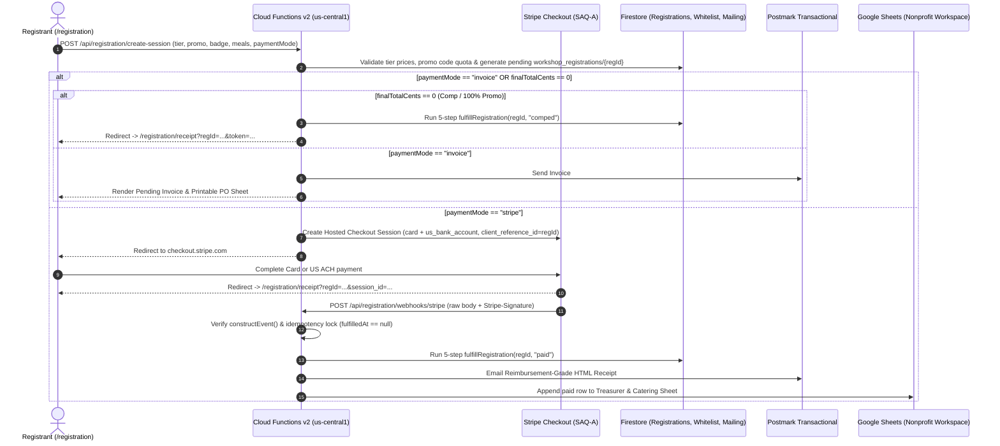

# Architecture & Implementation Plan: 16th HEMS Workshop (2027) Registration — Option 1

**Date:** 2026-11-15  
**Status:** Implemented (Phases 1–3 Built & Verified Locally; Phase 4 Pre-2027 Production Go-Live Pending Stripe Keys / 2027 Google Sheet Dates) — `@arch`, `@prod`, `@web`, `@dev`, `@ops`, `@legal`  
**Scope:** Native registration checkout gated by Google-Sheets **Auto-Advance** lifecycle (`reg_opening_date` -> `reg_early_bird_closes` -> `conference_end_date` / `exact_dates`), automated Stripe Card/ACH + Official Invoice/PO + Promo fulfillment, `whitelist` & `mailing_subscribers` sync, reimbursement-grade receipts, badge/catering logistics, and `$0/month` Google Nonprofits automation.

### Google-Sheets Auto-Advance Lifecycle Rules (Approved Update)
- **Before `reg_opening_date` (`now < openEpochMs` at `00:00:00` in `reg_timezone`) or while `"TBA"` with `registration_open === false`:** Interactive registration checkout UI is hidden/disabled for public visitors (`before_opening` / `unscheduled`), displaying the upcoming opening date and read-only fee schedule.
- **Early-Registration Window (`reg_opening_date <= now <= reg_early_bird_closes 23:59:59`):** Auto-opens registration with Early-Bird rates (`reg_student_early_fee` `$200`, `reg_professional_early_fee` `$425`, `reg_sponsor_early_fee` `$1,350`).
- **Regular Window (`reg_early_bird_closes < now <= conference_end_date 23:59:59`):** Auto-advances pricing to Regular rates (`reg_student_fee` `$250`, `reg_professional_fee` `$500`, `reg_sponsor_fee` `$1,350`). Accepts on-site / walk-up registrations throughout the symposium.
- **Post-Conference Auto-Close (`now > conference_end_date`, falling back to parsed range-end of `exact_dates` or `reg_final_cutoff`):** Automatically closes and disables registration after the final day of the conference (`concluded_closed`).
- **Guest Dinner & Optional Student Fund Defaults:** Guest Dinner Ticket (`reg_guest_dinner_fee`, default `$75`) and Optional Student Travel Award Donation (`+$25 / +$50 / +$100 / Custom`) included and itemized per IRC § 6115. Signed-in Board/Admin officers can also simulate any schedule phase on `/registration`.

---

## 1. Goals & `$0/Month` Non-Profit Cost Model

Because the Harsh-Environment Mass Spectrometry Society operates an all-volunteer biennial symposium (zero annual membership dues), the registration architecture must cost **$0.00/month in idle off-year overhead** while remaining compliant with university and federal government Purchase Card (`GPC`) auditing rules during active cycles.

| Stack Layer | Provider / Existing Asset | Standing Monthly Cost | Transaction / Usage Cost | Rationale |
| :--- | :--- | :--- | :--- | :--- |
| **Registration UI & Portal** | Next.js Static Export + Firebase Hosting | **`$0/mo`** | `$0` (free tier) | Zero extra SaaS; matches [RegistrationClient.tsx](file:///c:/AntigravityP1_2/HEMS-website/src/frontend/src/components/workshop/RegistrationClient.tsx) & Brand v3.2.0 |
| **Backend Orchestration** | Firebase Cloud Functions v2 (`us-central1`) + Firestore | **`$0/mo`** | `$0` (well inside 2M invocations / 50k reads/day free tier) | Reuses [functions/src/index.ts](file:///c:/AntigravityP1_2/HEMS-website/functions/src/index.ts) & [firebase.json](file:///c:/AntigravityP1_2/HEMS-website/firebase.json) API rewrites |
| **Transactional Email & Receipts** | Postmark (`hems-workshop.org`) | **`$0/mo`** *(or free/low tier)* | Existing HEMS stream (`TrackOpens: false`, `TrackLinks: "None"`) | Reuses [`functions/src/mailing.ts`](file:///c:/AntigravityP1_2/HEMS-website/functions/src/mailing.ts) delivery pipeline |
| **Treasurer & Catering Ledger Sync** | Google Workspace for Nonprofits + Google Sheets API v4 | **`$0/mo`** | `$0` (native Service Account write; no Zapier) | Direct write from Cloud Function via existing Firebase Admin IAM service account |
| **Card / Gov P-Card Checkout** | Stripe Hosted Checkout (`card`, Apple/Google Pay) | **`$0/mo`** | `2.9% + $0.30` *(e.g. ~$14.80 on `$500`)* | `SAQ-A` zero PCI burden; zero illegal SaaS "tip" prompts on `.gov`/`.mil` cards |
| **US Institutional ACH** | Stripe Hosted Checkout (`us_bank_account`) | **`$0/mo`** | `0.8%` (**`$5.00` cap**) | Saves `$35+` per `$1,350+` Corporate Sponsor vs. card (`$5` max fee) |
| **Invoice / Check / PO / Comp** | Native HEMS Pending-Invoice + Promo Ledger | **`$0/mo`** | **`$0.00`** | Essential for federal lab POs, university checks, sponsor comps & awardees |

> **Important 501(c)(3) Stripe Note:** Stripe’s `2.2% + $0.30` nonprofit discount strictly requires `>= 80%` of account volume to be pure tax-deductible charitable donations and **excludes** conference registration tickets. Planning around standard `2.9% + $0.30` for cards (`0.8%` / `$5`-capped for US ACH, `$0` for Check/PO) prevents unexpected fee adjustments or account holds.

### 4 Supported Payment & Fee-Containment Channels

1. **Stripe Hosted Checkout — Card / Digital Wallet (`2.9% + $0.30`):** Supports credit/debit, university travel cards, and NASA/DoD/DOE/NOAA GPC purchase cards without third-party platform tips or separate surcharge line items that travel auditors reject.
2. **Stripe Hosted Checkout — US ACH Direct Debit (`0.8%`, `$5.00` max):** Enabled alongside cards on Checkout Sessions for US registrants and Corporate Sponsors. Uses delayed settlement (`payment_intent.succeeded` / `checkout.session.async_payment_succeeded` vs `async_payment_failed`) cleanly in our webhook handler.
3. **Official Invoice / Check / Wire / PO Mode (`$0.00` fee):** Registrant submits the identical form choosing *"Request Official Invoice (Pay by Check, ACH, or Institutional PO)"*. Creates `status: "pending_invoice"` + sequential `HEMS-2027-INV-XXXX`, emails an invoice + W-9 remittance block via Postmark, and holds whitelist/tag activation until the Treasurer clicks **Mark Paid** in `/board/registrations`.
4. **Promo / Comp / Sponsor-Seat / Student-Awardee Waiver Codes (`$0.00` when balance is `$0`):** Atomic single-use or quota-limited coupon codes (`workshop_promo_codes/{CODE}`) issued for Corporate Sponsor complimentary seats, Host Patron reps, Invited Speakers, or Student Travel Awardees—bypassing Stripe automatically when net due `== $0` while still capturing badge, meal, abstract link, mailing tag, and whitelist entries.

---

## 2. End-to-End Fulfillment Architecture

### Sequence Diagram



### Cloud Functions Endpoints & Rewrites ([`firebase.json`](file:///c:/AntigravityP1_2/HEMS-website/firebase.json))

| HTTP Rewrite Path | Cloud Function (`us-central1`) | Auth / Trust Boundary | Responsibility |
| :--- | :--- | :--- | :--- |
| `/api/registration/create-session` | `registrationCreateSession` | Public (validated + optional Firebase ID token + honeypot) | Computes authoritative server-side line items from workshop fee schedule, validates promo code transactionally, creates `workshop_registrations/{regId}`, returns Stripe Checkout URL or completes `pending_invoice` / `$0 comped` flow. |
| `/api/registration/webhooks/stripe` | `registrationWebhookStripe` | Raw body `Stripe-Signature` HMAC (`req.rawBody`) | Handles `checkout.session.completed`, `checkout.session.async_payment_succeeded`, `checkout.session.async_payment_failed`, and `charge.refunded`. Idempotently runs `fulfillRegistration()` on settlement. |
| `/api/registration/receipt` | `registrationGetReceipt` | `regId` + `receiptToken` (`crypto.randomBytes(24)`) OR owner ID token | Returns read-only receipt/invoice JSON for the printable `/registration/receipt` sheet without exposing other attendees' PII. |
| `/api/registration/admin-action` | `registrationAdminAction` | Verified Firebase ID Token + Board/Admin role check | Supports **Mark Invoice Paid** (runs `fulfillRegistration`), **Transfer Seat to Colleague**, **Issue Refund / Cancel**, **Resend Receipt**, **Promo Code CRUD**, and **Manual Sheet Resync**. |

### Atomic 5-Step Post-Payment Fulfillment (`fulfillRegistration`)

Triggered once per registration (guarded by Firestore transaction on `fulfilledAt === null`) when Stripe confirms payment, `$0` promo comp is submitted, or Treasurer marks an invoice paid:

1. **Sequential Receipt & Registration Ledger Update (`workshop_registrations/{regId}`):**
   - Atomically increments `workshop_counters/2027.receiptSeq` to mint sequential `receiptNumber: "HEMS-2027-0001"` (used for audit & university reimbursement matching).
   - Stores `status: "paid" | "comped"`, `paidAt`, `receiptNumber`, `paymentSummary` (e.g., `Visa •••• 4242` / `US ACH` / `Check #1042`), and `fulfilledAt`.
2. **Cycle-Scoped Whitelist Role Assignment (`whitelist/{emailLower}` — preserving Officer Roles):**
   - Performs a Firestore transaction reading `whitelist/{emailLower}`.
   - Unions `"attendee"` (plus `"corporate sponsor"` if `tier === "sponsor"` or promo grants sponsor role) into the existing `roles` array—**never overwriting** existing `"admin"`, `"board"`, `"reviewer"`, or `"submitter"` roles.
   - Adds `workshopYears: arrayUnion(2027)` alongside structured profile fields (`firstName`, `lastName`, `affiliation`, `name`, `updatedAt`).
   - Because [`syncWhitelistToUserV2`](file:///c:/AntigravityP1_2/HEMS-website/functions/src/index.ts#L19-L66) watches `whitelist/{email}`, any existing or future Firebase Auth user with that email automatically syncs `users/{uid}.roles` for portal & abstract submission privileges.
3. **Mailing List Cohort Tagging (`mailing_subscribers/{emailDocId}`):**
   - Uses `emailDocId()` matching [`functions/src/mailing.ts`](file:///c:/AntigravityP1_2/HEMS-website/functions/src/mailing.ts#L60-L62).
   - Ensures `"2027 Attendees"` (and `"2027 Corporate Sponsors"` if applicable) exists in `mailing_subscribers/_meta_sublists`.
   - Upserts subscriber document with `firstName`, `lastName`, `institution: affiliation`, `sublists: arrayUnion("2027 Attendees")`.
   - Sets `status: "active"` for new signups or upgrades `"pending_opt_in"`; respects prior explicit `"unsubscribed"` marketing opt-outs unless registrant checks the registration opt-in box (while always delivering transactional workshop logistics/receipts).
4. **Abstract Submission Cross-Link (`abstract_submissions`):**
   - Queries `abstract_submissions` where `workshopYear == 2027` and (`submittedByEmail == emailLower` or `correspondingEmail == emailLower`).
   - Stores matching IDs in `linkedAbstractIds` so the Program Chair & Board console immediately flag unregistered accepted presenters (`Accept (Oral)` / `Accept (Poster)`) before final program publication.
5. **Reimbursement-Grade Postmark Receipt + Live Google Sheets Sync:**
   - **Postmark Email Receipt:** Sends itemized HTML/text receipt + link to `/registration/receipt?regId=...&token=...` via [`buildScholarlyLetterHtml`](file:///c:/AntigravityP1_2/HEMS-website/functions/src/mailing.ts#L76) conventions (`TrackOpens: false`, `TrackLinks: "None"`). Displays HEMS legal name, IRS `501(c)(3)` public charity designation + **EIN**, workshop title/dates/hotel, Attendee Name & Badge Affiliation, Registration Tier, Wednesday Dinner + Guest Dinner line items, optional Student Travel Award donation line, Payment Method, `Amount Paid`, `Balance Due: $0.00`, and **IRS IRC §§ 170 / 6115 Quid-Pro-Quo Disclosure** (*separately stating that registration/meal fees are exchanged for symposium goods & services and are not charitable contributions, while any voluntary Student Travel Award add-on is deductible to the extent allowed by law*).
   - **Google Sheets API v4 Append/Update:** Appends or updates the registrant row in the configured `GOOGLE_REGISTRATION_SHEET_ID` spreadsheet (Tabs: `2027 Roster & Financials`, `Catering & Meals`, `Pending Invoices`) using the Firebase Admin service account—giving the Treasurer real-time Google Workspace visibility at `$0` extra cost. Failure to sync Sheets logs an alert on the doc (`sheetSyncStatus: "error"`) without blocking payment fulfillment or email delivery, and can be retried in one click from `/board/registrations`.

---

## 3. Data Model & Firestore Security Rules

### Collections (`src/frontend/src/types/registration.ts`)

* **`workshop_registrations/{regId}` (`WorkshopRegistrationRecord`):**
  * *Identity & Portal:* `id`, `workshopYear` (`2027`), `email` (normalized lowercase), `firstName`, `lastName`, `affiliation`, `country`, `linkedUid?`
  * *Badge Details:* `badgeName` (preferred display name on lanyard), `badgeAffiliation` (short label), `pronouns?`
  * *Tier & Pricing:* `tier` (`"student" | "professional" | "sponsor" | "invited"`), `promoCodeUsed?`, `baseFeeCents`, `discountCents`, `guestDinnerCount` (`0 | 1 | 2`), `guestDinnerUnitCents`, `optionalStudentFundDonationCents`, `totalCents`, `stripeFeeEstimatedCents?`, `netEstimatedCents?`
  * *Student Verification (when `tier === "student"`):* `studentDegreeProgram` (`"M.S." | "M.A." | "Ph.D." | "B.S./Undergraduate"`), `studentAdvisorName`, `studentAdvisorEmail`
  * *Meals & Logistics:* `wednesdayDinnerRsvp` (`"attending" | "declining" | "undecided"`), `dietaryRestrictions` (`string[]` — Vegetarian, Vegan, Gluten-Free, Dairy-Free, Kosher/Halal, None), `allergyNotes?`, `guestNames?`, `guestDietaryNotes?`
  * *Abstract & History Cross-Links:* `linkedAbstractIds: string[]`, `transferHistory?: Array<{ fromEmail: string; toEmail: string; transferredBy: string; transferredAt: string }>`, `transferredFromRegId?`, `transferredToEmail?`
  * *Payment & Fulfillment State:* `paymentMode` (`"stripe" | "invoice" | "comped"`), `status` (`"checkout_started" | "pending_invoice" | "paid" | "comped" | "refunded" | "transferred" | "cancelled"`), `invoiceNumber?`, `receiptNumber?`, `receiptToken`, `stripeSessionId?`, `stripePaymentIntentId?`, `paymentSummary?`, `createdAt`, `updatedAt`, `paidAt?`, `fulfilledAt?`, `sheetSyncStatus?`, `checkedInAt?`
* **`workshop_promo_codes/{codeUpper}` (`WorkshopPromoCode`):**
  * `code` (uppercase alphanumeric), `label` (e.g. `"INFICON Sponsor Seat #1"`), `workshopYear` (`2027`), `discountType` (`"percent" | "fixed_cents"`), `discountValue`, `allowedTiers` (`Array<"student" | "professional" | "sponsor" | "invited">`), `grantsSponsorRole?: boolean`, `maxUses: number`, `usesCount: number`, `active: boolean`, `expiresAt?: string`, `notes?: string`

### [`firestore.rules`](file:///c:/AntigravityP1_2/HEMS-website/firestore.rules) Hardening

```javascript
match /workshop_registrations/{regId} {
  // Registrants can read their own registrations; Board & Admins can read/list all
  allow get: if request.auth != null && (
    isBoardOrAdmin(request.auth.uid)
    || (request.auth.token.email != null
        && resource.data.email == request.auth.token.email.lower())
  );
  allow list: if request.auth != null && (
    isBoardOrAdmin(request.auth.uid)
    || (request.auth.token.email != null
        && resource.data.email == request.auth.token.email.lower())
  );
  // All creations/updates occur exclusively through Cloud Functions Admin SDK
  allow write: if false;
}

match /workshop_promo_codes/{code} {
  allow read: if request.auth != null && isBoardOrAdmin(request.auth.uid);
  allow write: if false;
}

match /workshop_counters/{docId} {
  allow read, write: if false;
}
```

---

## 4. Frontend Surfaces

### A. Upgraded `/registration` & `/registration/receipt` ([`RegistrationClient.tsx`](file:///c:/AntigravityP1_2/HEMS-website/src/frontend/src/components/workshop/RegistrationClient.tsx))

* **Public Gate + Board Sandbox Preview:** While `workshop.registration_open === false`, public visitors continue to see the existing clean Save-the-Date notice. Signed-in `board` or `admin` officers see an inline **"Board Sandbox Preview Mode"** toggle on `/registration` to test the full checkout form, Stripe Test cards/ACH, promo codes, invoice generation, and printable receipts before 2027 public launch.
* **Single-Page Mobile-Clean Checkout Flow (Brand v3.2.0):**
  1. **Tier Selection + Live Promo Code Validator:** Student (`$250`), Professional (`$500`), Corporate Sponsor / Table (`$1,350`), dynamically read from [`upcoming_workshop.json`](file:///c:/AntigravityP1_2/HEMS-website/src/frontend/src/data/upcoming_workshop.json) / Google Sheet config (`workshop`). Shows Sponsor seat benefits, conditional **Student Advisor & `.edu` Verification** fields when Student is selected, and instant server promo-code validation on blur/submit.
  2. **Registrant & Name Badge Block:** First Name, Last Name, Institutional Email (auto-lowercased for `whitelist` + `mailing_subscribers` matching), Affiliation, Country, **Badge Display Name**, and **Badge Affiliation** (auto-filled from contact info, editable for informal names like *"Tim"*).
  3. **Catering, Guest Dinner & Student Fund Options:**
     * Wednesday Workshop Dinner RSVP (`Attending` / `Not Attending`) + Dietary checkboxes + Allergy free-text.
     * Optional **Spouse / Guest Workshop Dinner Ticket** selector (`0` or `1+` guests, guest name & dietary notes).
     * Optional **Tax-Deductible Contribution to HEMS Student Travel Awards** (`None`, `+$25`, `+$50`, `+$100`, or custom amount) itemized cleanly on receipts under IRC § 6115.
  4. **Mailing & Policy Consents + Payment Mode:** Checkbox pre-checked (`Add me to the 2027 Attendees workshop logistics & Society mailing list`), refund/transfer deadline acknowledgment, and choice of **Pay Online Now (Card / GPC / Apple Pay / US ACH via Stripe)** vs. **Request Official Invoice (Pay by Check, Wire, or PO)**.
* **Token-Authenticated Printable Receipt / Invoice Page (`/registration/receipt`):** Uses `@media print` styling (`1-page Letter`, exact pattern used by [`AbstractSubmissionClient.tsx`](file:///c:/AntigravityP1_2/HEMS-website/src/frontend/src/components/workshop/AbstractSubmissionClient.tsx) & [`StudentAwardsClient.tsx`](file:///c:/AntigravityP1_2/HEMS-website/src/frontend/src/components/workshop/StudentAwardsClient.tsx)) so attendees can immediately click **Print / Save PDF for Expense Report** or print an official **Unpaid Invoice + W-9 Remittance Form** to hand to their university/agency finance office.

### B. Treasurer & Chair Console (`/board/registrations`)

Added as a new portal tab (`src/frontend/src/app/(portal)/board/registrations/page.tsx`) linked from [`(portal)/layout.tsx`](file:///c:/AntigravityP1_2/HEMS-website/src/frontend/src/app/%28portal%29/layout.tsx) and [`board/page.tsx`](file:///c:/AntigravityP1_2/HEMS-website/src/frontend/src/app/%28portal%29/board/page.tsx) (Board + Admin only):

* **KPI Overview Strip:** Paid/Comped Headcount, Pending Invoices (`$ Total Pending`), Gross vs. Net After Est. Processing Fees, Tier Breakdown (Student / Professional / Sponsor / Comped), Wednesday Dinner + Guest Meal Headcount (`+ Dietary Allergy Alert list`), and **Accepted Abstract Presenters Not Yet Registered** badge counter.
* **Actionable Registrant Table:**
  * Search & filter by Tier, Payment Status (`paid`, `pending_invoice`, `comped`, `refunded`), Dietary Flag, or `Unregistered Abstract Presenter`.
  * **Mark Invoice Paid** (opens modal for Check # / ACH Reference / Payment Date -> executes 5-step `fulfillRegistration()`).
  * **Transfer Seat to Colleague** (swaps attendee name/email/badge/dietary, revokes `"2027 attendee"` from original email if they have no other paid reg, grants `"attendee"` + `"2027 Attendees"` to replacement email, emails confirmation to both—zero Stripe fee lost).
  * **Resend Itemized Receipt / Issue Stripe Refund / Check-In Toggle** (for on-site registration desk tablets).
* **Promo Code & Fee-Waiver Manager Tab:** Create/disable/track Sponsor Seat codes, Host Patron comps, Invited Speaker codes, and Student Travel Awardee waivers.
* **1-Click Export Center:**
  1. **Treasurer Reconciliation CSV** (Receipt #, Stripe Intent / Check #, Tier, Dinner, Optional Donation, Gross, Est. Fee, Net, Tax-Deductible Portion).
  2. **Hotel Catering & Meal Headcount CSV** (Wednesday Dinner total + itemized allergies/dietary counts including guest tickets).
  3. **Printable Avery 5395 (`4"×3"`) Name Badges & Alphabetical Check-In Roster PDF** (in-browser print sheet + `jsPDF` matching [`package.json`](file:///c:/AntigravityP1_2/HEMS-website/src/frontend/package.json#L17)).

---

## 5. Phased Delivery Roadmap

| Phase | Owner(s) | Deliverables | Exit Criteria |
| :--- | :--- | :--- | :--- |
| **Phase 1: Schema, Rules & UI Shell** | `@arch`, `@dev`, `@qa` | `types/registration.ts`, updated `firestore.rules`, upgraded `/registration` checkout form (hidden behind `registration_open` for public, toggleable via **Board Sandbox Preview**), `/registration/receipt` print sheet | `tsc --noEmit` passes; Board officer can preview full mobile & desktop checkout without changing public site state |
| **Phase 2: Stripe Test Mode & 5-Step Fulfillment** | `@dev`, `@ops` | Install `stripe` SDK in `functions/`, implement `registrationCreateSession`, `registrationWebhookStripe`, `registrationGetReceipt`, `fulfillRegistration()` (sequential receipt #, cycle-scoped `whitelist` union, `mailing_subscribers` `"2027 Attendees"` tagging, abstract cross-link, Postmark receipt + IRC § 6115 disclosure) | End-to-end sandbox Card (`4242...`) + Test US ACH + `$0` Promo + Invoice submit verified against Stripe Test dashboard & Firebase emulators/project |
| **Phase 3: `/board/registrations` & Google Sheets Sync** | `@dev`, `@web`, `@ops` | Build `/board/registrations` Treasurer Console (Invoice approval, Colleague Seat Transfer, Promo Code Manager, Presenter-vs-Registrant reconciliation, Avery 5395 Badge PDF), wire `googleapis` Sheets v4 append/sync using Service Account | Treasurer can approve a mock invoice, transfer a seat, export Catering & Treasurer CSVs, print badges, and see rows land in a test Google Sheet |
| **Phase 4: Pre-2027 Production Go-Live** | `@ops`, `@bo` | Configure Stripe Live `sk_live_...` & `whsec_...` secrets (`firebase functions:secrets:set`), add official Society EIN & remittance mailing address/W-9 PDF link for invoices, share 2027 Google Sheet with Firebase service account, flip `registration_open = TRUE` in workshop config sheet | `@bo` test-buys and refunds one live `$1` test code; Board signs off before opening 2027 Early Bird registration |

---

## 6. Open Policy Decisions Needed from `@bo`

Before `@dev` starts Phase 1–3 implementation (which can be built and tested completely behind **Board Sandbox Mode** well before 2027), please confirm your preferences on these four points:

1. **Card Processing Fee Strategy:** Should headline prices stay exact (`$250` Student / `$500` Professional / `$1,350` Sponsor) with HEMS absorbing the `2.9% + $0.30` card fee (~\$14.80 on \$500), OR slightly raise card-inclusive headline prices (e.g., `$260` / `$515`) so net proceeds match `$250` / `$500`? *(We recommend keeping pricing single-line and never adding a separate "credit card surcharge" fee on federal travel receipts.)*
2. **Spouse / Guest Wednesday Workshop Dinner Ticket:** Should the form include an optional extra Guest Dinner Ticket purchase during registration (if yes, what placeholder ticket price—e.g. `$75` or `$85`, always overridable in the workshop Google Sheet)?
3. **Optional Student Travel Award Add-On Donation:** Should registrants see a small optional tax-deductible add-on checkbox/selector (`+$25`, `+$50`, `+$100`) to help fund the `$1,500` Student Travel Awards (with separate charitable-gift line item on the IRC § 6115 receipt)?
4. **Build Timeline:** Do you want `@dev` and `@ops` to build and test **Phases 1–3 in Stripe Test / Board Sandbox Mode** soon (while keeping public visitors on Save-the-Date until 2027), or park this blueprint until 2027 workshop planning begins?
