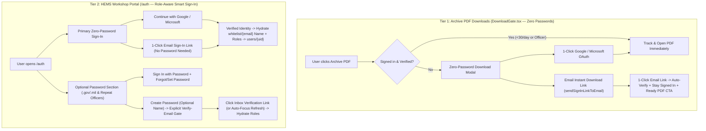

# Architectural Plan: Two-Tier Smart Sign-In, Pre-Whitelisted Role Hydration & Password-Free Download Gate

**Date:** 2026-11-17  
**Author:** `@arch` (with `@prod`, `@brand`, `@dev`, `@qa`)  
**Status:** Completed & Verified (`53/53` static routes built, `0` TS errors, unit suites passing)

---

## 1. Problem Statement & Root Causes

A real-world login audit surfaced four coupled UX and state-synchronization defects affecting pre-whitelisted HEMS participants (Attendees, Abstract Reviewers, Operations Officers, Treasurer, Board Members, and Administrators whose email, name, and roles were pre-assigned in `whitelist/{email}`):

1. **Unverified Manual Password Signups Showed Zero Assigned Roles Silently:**
   - `register()` in [`AuthContext.tsx`](file:///c:/AntigravityP1_2/HEMS-website/src/frontend/src/context/AuthContext.tsx) intentionally restricts unverified email+password accounts to `roles: ["general"]` in Firestore (`roles: []` in UI) until `emailVerified === true` (preventing an attacker from pre-registering a committee member's email before them).
   - However, [`auth/page.tsx`](file:///c:/AntigravityP1_2/HEMS-website/src/frontend/src/app/auth/page.tsx) immediately displayed *"Account created! You may now enter the portal."* with **zero warning** that email verification was required to unlock pre-assigned HEMS roles, and [`(portal)/layout.tsx`](file:///c:/AntigravityP1_2/HEMS-website/src/frontend/src/app/%28portal%29/layout.tsx) displayed no unverified-email banner inside the portal.
2. **"Sign In vs. Create Account" Dead-End for Pre-Whitelisted Emails:**
   - Adding an email to Firestore `whitelist/{email}` does not create a Firebase Auth password record. Pre-whitelisted users naturally clicked **Sign In**, received raw `Firebase: Error (auth/invalid-credential).`, and were forced into **Create Account**, where they had to re-enter a mandatory **Full Name** even though HEMS already had their official name and roles on file.
3. **Unnecessary Password Friction on Proceedings PDF Downloads:**
   - [`DownloadGate.tsx`](file:///c:/AntigravityP1_2/HEMS-website/src/frontend/src/components/DownloadGate.tsx) duplicated a full `Full Name + Email + Password` registration form just to view historical workshop slides/abstracts, plus suffered from a stale React closure bug (`const isVerifiedNow = isMock || emailVerified` read immediately after `await reloadUser()` before re-render).
4. **Incomplete `users/{uid}` Firestore Sync After Verification:**
   - `onAuthStateChanged`, `login()`, and `handleOAuthLogin()` computed `wl.roles` in memory for existing `users/{uid}` docs without writing `wl.rawRoles` or hydrating `wl.name` (when `users/{uid}.name` was a placeholder) back to Firestore `users/{uid}`.

---

## 2. Two-Tier Authentication Architecture

---

## 3. Component-by-Component Implementation Specification

### 3.1 Central Identity & Whitelist Sync Engine ([`AuthContext.tsx`](file:///c:/AntigravityP1_2/HEMS-website/src/frontend/src/context/AuthContext.tsx))
- **New Firebase Auth Capabilities (`firebase/auth`):**
  - `sendSignInLinkToEmail`, `isSignInWithEmailLink`, `signInWithEmailLink`, and `sendPasswordResetEmail`.
- **Context Contract Additions:**
  - `sendMagicSignInLink(email, options?: { returnPath?: string; pendingDownloadUrl?: string }): Promise<void>`
  - `completeEmailLinkSignIn(emailOverride?: string): Promise<{ completed: boolean; needsEmailPrompt: boolean; pendingDownloadUrl?: string | null; returnPath?: string | null }>`
  - `sendPasswordReset(email: string): Promise<void>`
  - `pendingEmailLinkPrompt: boolean` (true if user opened a sign-in link on a different device/browser without `hems_email_for_sign_in_v1` in `localStorage`)
  - `readyDownloadUrl: string | null` + `clearReadyDownloadUrl: () => void` (surfaces a popup-blocker-safe PDF download CTA immediately after returning from an email sign-in link)
  - `reloadUser(): Promise<boolean>` (returns fresh `trustedIdentity` boolean directly, eliminating stale closure bugs).
- **Centralized Whitelist Name & Role Hydration:**
  - Enhance `fetchWhitelistEntry(email)` to resolve `name` from `data.name` or `[data.firstName, data.lastName]` and preserve exact `data.roles` in `rawRoles` so `users/{uid}` updates satisfy [`firestore.rules`](file:///c:/AntigravityP1_2/HEMS-website/firestore.rules) (`request.resource.data.roles == get(.../whitelist/$(email)).data.roles`).
  - Force `firebaseUser.getIdToken(true)` whenever an existing unverified profile transitions to `trustedIdentity === true` so Firestore security rules immediately observe `request.auth.token.email_verified == true`.
  - Persist `{ emailVerified: true, roles: wl.rawRoles, name: resolvedName }` back to `users/{uid}` across `onAuthStateChanged`, `handleOAuthLogin`, `login`, `completeEmailLinkSignIn`, and `reloadUser` (preferring `wl.name` whenever stored `name` is empty or a generic email-prefix placeholder).
  - Attach a throttled (`4s`) `window` `focus` / `visibilitychange` auto-check while `user && !fbEmailVerified` so switching back from an email tab unlocks roles automatically.
- **Human-Readable Firebase Error Translator (`formatFirebaseAuthError`):**
  - Maps `auth/invalid-credential`, `auth/user-not-found`, `auth/wrong-password`, `auth/email-already-in-use`, `auth/weak-password`, `auth/operation-not-allowed`, `auth/invalid-action-code`, `auth/expired-action-code`, `auth/too-many-requests`, and `auth/popup-closed-by-user` to clear scholarly English.

### 3.2 Tier 1 — Zero-Password Proceedings Access ([`DownloadGate.tsx`](file:///c:/AntigravityP1_2/HEMS-website/src/frontend/src/components/DownloadGate.tsx))
- Remove `Password`, `Full Name`, and `Sign In / Create Account` tabs from `DownloadGate.tsx`.
- Present a streamlined **Instant Proceedings Access (No Password Required)** dialog:
  1. **1-Click OAuth:** `Continue with Google` and `Continue with Microsoft` (opens PDF immediately on completion, with a 1-tap fallback link if mobile Safari blocks async `window.open`).
  2. **Email Instant Download Link:** Single `Email Address` input + `Email Me an Instant Download Link` (`sendMagicSignInLink` storing `returnPath` and `pendingDownloadUrl`).
- Handle cross-device link opens (`pendingEmailLinkPrompt`) and post-link return (`readyDownloadUrl`) directly in `DownloadGate.tsx`.
- Fix `showVerifyModal` (for users already logged into an unverified password session) to await the boolean returned by `await reloadUser()`.

### 3.3 Tier 2 — Smart Role-Aware Portal Login ([`auth/page.tsx`](file:///c:/AntigravityP1_2/HEMS-website/src/frontend/src/app/auth/page.tsx))
- **Auto-Complete Incoming Email Sign-In Links:** Show a clean verification state on `?mode=signIn&oobCode=...` (or single-field email confirmation if opened on another device) and route to `returnPath` or `/layout-portal`.
- **Lead with Zero-Password Sign-In:**
  1. `Continue with Google` & `Continue with Microsoft`.
  2. `Send 1-Click Sign-In Link` (single email field — ideal for pre-whitelisted Attendees, Reviewers, and Board members).
- **Clean Password Drawer / Mode (`Sign In with Password` | `Set Password` | `Reset / Set Password via Email`):**
  - Optional `Display Name` when creating a password (*"Optional — pre-assigned HEMS names & roles load automatically after email verification"*).
  - Contextual recovery buttons when `Sign In` returns `auth/invalid-credential` (`[Send 1-Click Sign-In Link]` / `[Email Password Setup Link]`).
  - Dedicated **"Verify Your Email to Activate HEMS Roles"** screen after password creation (replacing misleading *"You may now enter the portal"*), with `[I've Verified — Unlock My Roles]`, `[Resend Verification Email]`, and `[Continue to General Portal →]`.

### 3.4 Portal Unverified-Email Banner ([`(portal)/layout.tsx`](file:///c:/AntigravityP1_2/HEMS-website/src/frontend/src/app/%28portal%29/layout.tsx))
- Render an amber verification notice at the top of the portal content column whenever `user && !emailVerified && !isMock`, explaining that pre-assigned HEMS roles and PDF downloads activate upon clicking the inbox verification link, with `[I've Verified — Unlock My Roles]` and `[Resend Verification Email]` controls.

---

## 4. Security & Operational Checklist

- **Zero Weakening of [`firestore.rules`](file:///c:/AntigravityP1_2/HEMS-website/firestore.rules):** Unauthenticated enumeration of `whitelist/{email}` remains blocked, and unverified password accounts cannot claim `whitelist/{email}` roles until `email_verified == true`.
- **One-Time Firebase Console Toggle (Before Production Push):** In Firebase Console → **Authentication → Sign-in method → Email/Password**, enable **"Email link (passwordless sign-in)"** and Save. (If clicked before toggled, `auth/operation-not-allowed` is caught cleanly and guides the user to Google, Microsoft, or Password.)
- **Verification Gates (`@qa`):**
  1. `npx --prefix src/frontend tsc -p src/frontend/tsconfig.json --noEmit` (`0` errors)
  2. `node tests/unit/upcomingWorkshopCsv.test.mjs` (`PASS`)
  3. `npm --prefix src/frontend run build` (`53/53` static routes exported cleanly)
